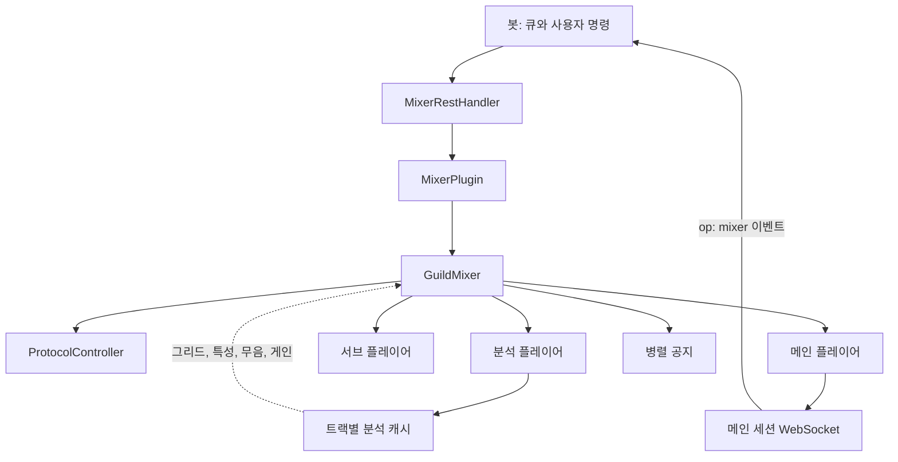
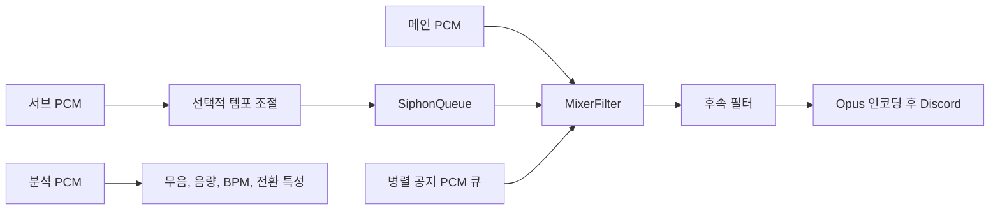
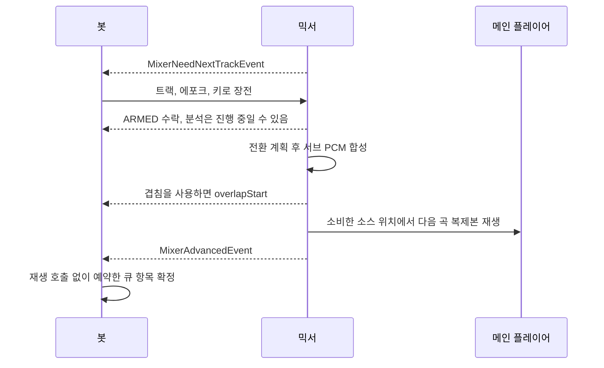

# lavalink_mixer

[English](README.md) | [한국어](README.ko.md)

[](https://github.com/mochilabs/lavalink_mixer/releases/latest)
[](UNLICENSE)
[](https://github.com/lavalink-devs/Lavalink)
[](https://adoptium.net)

서버에서 Opus 인코딩 전에 오디오를 합성하는 Kotlin 기반 [Lavalink v4](https://github.com/lavalink-devs/Lavalink) 플러그인입니다.

- 이퀄 파워 크로스페이드와 겹침 없는 서버 주도 곡 전환.
- 2·4·8박자 비트 매칭, 일시적인 템포 조절, 다음 곡의 원래 속도로 복귀.
- 구간별 에너지, 리듬, 조성 추정치, 무음에 따른 전환 방식 선택.
- 곡 앞뒤 무음 제거와 실시간 끝무음 감지.
- EBU R128 음량 측정과 설정한 목표 음량까지 감쇠. 기본 목표는 -14 LUFS.
- 음악 덕킹과 좌우 채널 선택을 지원하는 순차·병렬 공지 오디오.
- 에포크와 멱등성 키를 사용하는 프로토콜 v2 큐 제어.

Lavalink 소스를 수정할 필요가 없습니다. 분석은 별도 디코더에서 Kotlin/JVM 코드로 수행합니다. 템포 조절은 서버가 제공하는 `lavadsp` 네이티브 기능을 사용하며, 네이티브 처리에 실패하면 속도를 조절하지 않은 PCM으로 폴백합니다. Lavalink, Lavaplayer, lavadsp는 서버에서 제공해야 합니다.

## 관련 문서

- [REST 및 WebSocket 명세](api/openapi.yaml)
- [봇 연동 가이드](examples/lavalink-client/README.md)
- [한국어 상세 봇 연동 가이드](examples/lavalink-client/README.ko.md)
- [아키텍처 및 스레딩](docs/architecture.md)
- [빌드 및 테스트 가이드](docs/development.md)
- [BPM 검출기 설계](docs/bpm-detector-design.md)와 [BPM 캘리브레이션](docs/bpm-calibration.md)
- [BPM 추출 알고리즘 해설](docs/bpm-extraction.ko.md)
- [적응형 전환 캘리브레이션](docs/adaptive-calibration.md)

## 빠른 시작

### 1. 플러그인 설치

[Releases](https://github.com/mochilabs/lavalink_mixer/releases)에서 `lavalink_mixer-<version>.jar`를 내려받아 Lavalink의 `plugins/` 디렉터리에 넣고 서버를 재시작합니다. [소스에서 JAR을 빌드](#소스-빌드)할 수도 있습니다.

Lavalink의 `Authorization` 헤더를 포함해 `GET /mixer/info`를 호출하여 로드를 확인합니다. 실행 중인 JAR 버전, `protocolVersion: 2`, 위치 지정 지원 여부를 반환합니다.

현재 코드는 Lavalink plugin API 4.2.2, Lavaplayer 2.2.6, lavadsp 0.7.8을 기준으로 컴파일하며 JVM 17을 대상으로 합니다. 호환되는 Lavalink 서버를 사용합니다.

### 2. 플레이어별 필터 활성화

재생 전에 Lavalink v4의 [Update Player API](https://lavalink.dev/api/rest#update-player)를 호출합니다.

```http
PATCH /v4/sessions/{sessionId}/players/123456789012345678
Authorization: <Lavalink password>
Content-Type: application/json

{
	"filters": {
		"pluginFilters": {
			"mixer": {
				"guildId": "123456789012345678"
			}
		}
	}
}
```

`sessionId`는 WebSocket `ready` 메시지의 Lavalink 세션 ID입니다. `filters` 갱신은 기존 필터 설정을 교체하므로 필요한 다른 필터도 함께 보냅니다. 이후 갱신에서도 `pluginFilters.mixer`를 유지하고, 플레이어를 새로 만들면 다시 적용합니다.

JSON의 길드 ID는 문자열로 보냅니다. Discord Snowflake는 JavaScript의 안전한 정수 범위를 넘을 수 있습니다. 믹서 API는 같은 서버의 `/mixer/*` 경로를 사용하며 `/v4` 접두사를 붙이지 않습니다.

### 3. 봇 큐 연동

첫 곡은 Lavalink 클라이언트로 시작합니다. lavalink-client의 `autoSkip: false`처럼 클라이언트 자동 전환을 비활성화하고, `op: "mixer"`인 WebSocket 메시지를 봇 핸들러에 전달합니다.

`MixerNeedNextTrackEvent`를 받으면 `/mixer/queue/arm`으로 다음 곡을 장전합니다. `MixerAdvancedEvent`를 받으면 봇의 큐와 현재 곡 표시를 갱신합니다. 해당 곡은 서버에서 이미 재생 중입니다. 클라이언트의 `trackEnd` 핸들러에서도 서버에 곡 전환을 맡깁니다.

자동 전환을 사용하려면 [프로토콜 v2 흐름](#큐-프로토콜-v2)을 구현해야 합니다. 필터 활성화만으로 다음 곡이 제공되지는 않습니다.

## 서버 기본 설정

Lavalink `application.yml`의 `mixer:` 블록에 시작 시 기본값을 설정합니다.

```yaml
mixer:
  # 크로스페이드 및 최초 페이드인
  crossfadeEnabled: true
  crossfadeMs: 5000
  fadeInMs: 300

  # 공지 덕킹 및 동시 재생 수
  duckLevel: 0.2
  duckFadeMs: 300
  maxParallelOverlays: 4

  # 음량 정규화
  normalizationEnabled: false
  targetLufs: -14.0

  # 무음 제거
  silenceSkipEnabled: false
  silenceThresholdDb: -60.0
  silenceMinSoundMs: 120
  silenceHeadScanMs: 15000
  silenceTailScanMs: 15000
  tailConfirmMs: 1000

  # BPM 검출 및 비트 매칭
  bpmDetectionEnabled: false
  bpmScanMs: 30000
  keyDetectionEnabled: false
  keyScanMs: 30000
  beatmatchEnabled: false
  maxTempoChange: 0.06
  beatmatchMinConfidence: 0.30

  # 공용 분석 워커 풀
  analysisThreads: 2
```

[API 표](#rest-api)에 있는 설정은 길드별 REST 요청으로 변경할 수 있습니다. 워커 수, 덕킹 램프 시간, 병렬 오버레이 상한에는 별도 REST 설정 API가 없습니다. `analysisThreads`는 1–8, `maxParallelOverlays`는 1–16으로 제한됩니다.

크로스페이드는 기본 활성화입니다. 추가 디코딩이 필요한 무음 제거, 정규화, BPM 검출은 기본 비활성화이며 비트 매칭도 기본 비활성화입니다.

## 곡 전환 및 오디오 처리

### 비트 매칭과 적응형 전환

비트 매칭에는 크로스페이드, BPM 검출, 비트 매칭이 모두 활성화되어 있어야 합니다. `/mixer/bpm`에서 검출과 매칭을 함께 활성화할 수 있습니다.

```http
POST /mixer/bpm
Authorization: <Lavalink password>
Content-Type: application/json

{
	"guildId": "123456789012345678",
	"enabled": true,
	"beatmatchEnabled": true,
	"scanMs": 30000,
	"maxTempoChange": 0.06,
	"minConfidence": 0.30
}
```

`/mixer/beatmatch`는 매칭만 변경하며 BPM 검출을 켜지 않습니다. 크로스페이드를 꺼 두었다면 `/mixer/crossfade`에서도 활성화합니다.

분석기는 곡 앞뒤의 비트 그리드와 전환 구간 특성을 추출합니다. 전환 계획은 경계 보존, 무음 제거, 이퀄 파워 크로스페이드, 비트 매칭 중 하나를 선택합니다. 비트 매칭 중에는 다음 곡을 현재 곡의 템포에 맞춘 뒤 핸드오프 전에 원래 속도로 복귀시킵니다. `overlapMs`는 두 곡의 페이드 구간이며, `recoveryMs`는 전체 전환 시간 안에서 다음 곡만 재생하며 속도를 복구하는 구간입니다.

그리드가 없거나 신뢰도가 낮고, 곡 조합이 적합하지 않거나 템포 차이가 너무 크면 일반 크로스페이드로 폴백합니다. 호환성을 위한 `short_crossfade` 이름은 설정한 크로스페이드 길이를 유지하되 현재 곡의 남은 콘텐츠 길이로 제한한다는 뜻입니다. 고정된 1.5초 페이드를 의미하지 않습니다.

비트 그리드 위상은 음악적 마디의 첫 박자가 아닙니다. 신뢰도는 주기성을 나타내며, 적응형 임계값은 대표적인 실제 음악으로 추가 보정이 필요한 휴리스틱입니다. 검출기 세부 동작과 한계는 [BPM 설계 문서](docs/bpm-detector-design.md)를 참고합니다.

### 크로스페이드, 무음 제거, 음량 정규화

크로스페이드는 이퀄 파워 게인과 합성 진폭 절댓값 `0.9` 이상의 소프트 리미팅을 사용합니다. 핸드오프 위치는 앞서 디코딩된 버퍼 위치가 아닌, 템포 조절을 반영해 실제 소비한 다음 곡 소스 샘플 수로 계산합니다.

무음 분석은 탐색 가능한 곡의 시작과 끝 부근을 디코딩합니다. 실시간 감지는 게인 적용 전 메인 PCM을 확인합니다. 길이를 아는 곡은 처음 5초 이후의 끝 구간에서 무음이 확인되어야 조기 전환할 수 있습니다. 스트림은 최소 `max(tailConfirmMs, 3000)` ms의 무음이 필요합니다. 장전된 다음 곡이 있으면 해당 곡으로 전환합니다.

정규화는 K-weighting, 75% 겹침의 400 ms 윈도, 절대·상대 음량 게이트를 사용합니다. 게인은 최대 `1.0`이므로 조용한 곡을 증폭하지 않습니다. REST로 목표 음량을 -30에서 -6 LUFS 사이로 설정할 수 있습니다.

### 공지 오디오

`POST /mixer/announce`에 인코딩된 트랙이나 소스 식별자를 보냅니다. 서버에 구성한 TTS 소스의 오디오를 포함해 제공된 음성을 재생하며, 플러그인 자체가 음성을 합성하지는 않습니다.

순차 공지는 크로스페이드와 서브 플레이어를 공유하며 사용 중이면 기다립니다. 병렬 공지는 별도 플레이어를 사용하고 `maxParallelOverlays`의 제한을 받습니다. 두 모드 모두 `channel: "both"`, `"left"`, `"right"`를 지원하며 메인 음악을 덕킹합니다. `/mixer/announce/cancel`은 재생 중인 순차 공지를 중단합니다. 대기 공지는 `DELETE /mixer/announce/queue?guildId=...`로 따로 비웁니다.

## 큐 프로토콜 v2

다음 곡 선택은 봇이 담당합니다. 첫 곡을 시작한 뒤 장전된 곡으로 전환하는 일은 플러그인이 담당합니다.

1. 서버가 프리페치 구간에서 `MixerNeedNextTrackEvent`를 보냅니다.
2. 봇이 정확한 Lavalink 인코딩 트랙, 에포크, `Idempotency-Key`로 `/mixer/queue/arm`을 호출합니다. 큐가 비었으면 `isEmpty: true`를 보냅니다.
3. 서버가 장전을 수락하고 분석을 예약합니다. `ARMED`는 곡을 수락했다는 뜻이며 분석 완료를 보장하지 않습니다.
4. 서버가 전환한 뒤 `handoffType: "CROSSFADE"` 또는 `"GAPLESS"`인 `MixerAdvancedEvent`를 보냅니다.
5. 봇이 같은 곡을 다시 재생하지 않고 로컬 큐를 동기화합니다.

프리페치 구간은 `crossfadeMs + 7000` ms입니다. BPM 검출과 비트 매칭을 켜면 `crossfadeMs + min(2 * bpmScanMs + 7000, 120000)` ms로 늘어납니다. 짧은 곡에는 500 ms의 안정화 지연이 있으며 리셋 유예 시간에 따라 발송이 더 늦어질 수 있습니다.

새 작업마다 새 키를 사용하고 같은 요청을 재시도할 때만 키를 재사용합니다. 서버는 길드별 최근 작업 지문 64개를 메모리에 저장합니다. 저장된 키와 지문이 일치하면 중복 응답을 반환하고, 지문이 다르면 HTTP 422를 반환합니다. 새 요청의 에포크가 이전 값보다 낮으면 HTTP 409이며 같은 에포크는 허용합니다. 리셋, 캐시 퇴출, 프로세스 재시작 이후에는 중복 방지 범위가 제한됩니다.

큐의 첫 곡이 바뀌면 더 높은 에포크와 새 키로 `/mixer/queue/invalidate`를 호출합니다. 장전된 곡을 비우고 프리페치 구간 안에서 다음 곡을 다시 요청할 수 있습니다. 사용자 스킵과 정지는 `/mixer/queue/override`의 `PLAY_NOW` 또는 `STOP`을 사용합니다. 플레이어 변경은 순서가 보장되는 실행기에서 처리하므로 `MixerOverriddenEvent`로 실행 완료를 확인합니다.

봇 시작이나 세션 재개 시 `/mixer/reset`으로 에포크를 동기화합니다. 리셋은 기존 값과 요청 값 중 큰 에포크를 유지하며 기본 1500 ms의 유예 구간을 엽니다. HTTP 409는 `lastKnownEpoch`를 기준으로 처리하고, `PRE_RESET_ARRIVAL`이면 `windowOpenAt`도 확인합니다.

### 전환 보존과 곡 경계 건너뛰기

장전 요청은 다음 선택 필드를 지원합니다.

| 필드 | 동작 |
| --- | --- |
| `preserveTransition` | 이 경계의 자동 겹침과 무음 제거를 생략합니다. 한 번의 장전에만 적용되며 지속적인 앨범 모드가 아닙니다. |
| `startPositionMs` | 다음 곡의 최소 시작 위치입니다. 겹침 없는 전환과 보존 전환에도 적용됩니다. 0이 아닌 값은 탐색 가능하며 500 ms보다 많은 재생 시간이 남은 곡에만 허용됩니다. |
| `outgoingEndPositionMs` | 현재 곡의 유효 종료점입니다. 여기서 페이드를 끝내거나 겹침 없이 다음 곡으로 전환합니다. 탐색 가능한 현재 곡, 비어 있지 않은 다음 곡, `preserveTransition: false`가 필요합니다. |

각 노드의 `/mixer/info`에서 `incomingStartPositionSupported`와 `outgoingEndPositionSupported`를 확인합니다. 두 위치 필드는 ms 단위이며 장전 요청의 멱등성 판정에 포함됩니다. `isEmpty: true`와 함께 보내지 않습니다. 현재 곡 종료점은 곡의 시작과 끝에서 각각 500 ms보다 멀어야 합니다. 장전 시 이미 지났거나 현재 위치에서 500 ms 이내인 종료점은 무시합니다.

봇은 SponsorBlock 구간처럼 인트로·아웃트로 경계를 이 옵션에 전달할 수 있습니다. 구간 조회와 선택은 봇이 담당합니다. `overlapStart.incomingStartMs`는 실제 겹침 재생에 선택된 다음 곡 시작 위치입니다.

## REST API

모든 요청은 `Bearer` 접두사 없이 Lavalink 비밀번호를 `Authorization` 헤더로 보냅니다. JSON의 길드 ID는 문자열입니다. 정확한 스키마, 응답, 수치 범위는 [OpenAPI](api/openapi.yaml)를 참고합니다. 생략한 선택 설정은 기존 값을 유지하며, 전달한 숫자는 명세의 허용 범위로 제한됩니다.

### 큐 및 재생

아래 네 큐 제어 작업에는 `Idempotency-Key`가 필요합니다.

| 메서드 | 경로 | 요청 | 결과 |
| --- | --- | --- | --- |
| `GET` | `/mixer/info` | 없음 | 실행 버전, 프로토콜 버전, 시작·종료 위치 지원 여부 |
| `GET` | `/mixer/state?guildId=...` | 길드 ID 쿼리 | 상태, 설정, 분석, 게인, BPM, 조성 추정, 전환 진단 |
| `POST` | `/mixer/analyze` | `{ guildId, encodedTrack }` | HTTP 202와 `accepted`. 캐시 예열이며 장전·재생하지 않음 |
| `POST` | `/mixer/queue/arm` | `{ guildId, epoch, encodedTrack?, isEmpty?, preserveTransition?, startPositionMs?, outgoingEndPositionMs? }` | 다음 곡 또는 빈 큐 수락 |
| `POST` | `/mixer/queue/invalidate` | `{ guildId, epoch }` | 장전 취소 및 조건에 따른 다음 곡 재요청 |
| `POST` | `/mixer/queue/override` | `{ guildId, epoch, action, encodedTrack? }` | `STOP` 또는 트랙이 필요한 `PLAY_NOW` 예약 |
| `POST` | `/mixer/reset` | `{ guildId, epoch, windowOpenGraceMs? }` | 에포크 동기화 및 대기 전환 상태 초기화 |

### DSP 설정 및 공지

다음 API에는 `Idempotency-Key`가 필요하지 않습니다.

| 메서드 | 경로 | 요청 |
| --- | --- | --- |
| `POST` | `/mixer/crossfade` | `{ guildId, enabled, durationMs? }`, 500–30000 ms |
| `POST` | `/mixer/fade-in` | `{ guildId, durationMs }`, 0–10000 ms |
| `POST` | `/mixer/bpm` | `{ guildId, enabled, scanMs?, beatmatchEnabled?, maxTempoChange?, minConfidence? }` |
| `POST` | `/mixer/key` | `{ guildId, enabled, scanMs? }` |
| `POST` | `/mixer/beatmatch` | `{ guildId, enabled, maxTempoChange?, minConfidence? }` |
| `POST` | `/mixer/silence` | `{ guildId, enabled, thresholdDb?, minSoundMs?, headScanMs?, tailScanMs?, tailConfirmMs? }` |
| `POST` | `/mixer/normalization` | `{ guildId, enabled, targetLufs? }` |
| `POST` | `/mixer/announce` | `{ guildId, identifier?, encodedTrack?, duckLevel?, mode?, channel? }`, HTTP 202 |
| `POST` | `/mixer/announce/cancel` | `{ guildId }` |
| `DELETE` | `/mixer/announce/queue?guildId=...` | 길드 ID 쿼리 |

## WebSocket 이벤트

기존 Lavalink WebSocket 연결에서 다음 사용자 정의 메시지를 처리합니다.

```jsonc
// 요청을 받으면 다음 곡을 장전합니다.
{ "op": "mixer", "type": "MixerNeedNextTrackEvent", "guildId": "123", "remainingMs": 12000, "currentTrackEncoded": "..." }

// 비트 매칭 시작. 전체 전환 시간에는 다음 곡만 재생하는 속도 복구 구간도 포함됩니다.
{ "op": "mixer", "type": "overlapStart", "guildId": "123", "crossfadeMs": 4500, "overlapMs": 4000, "recoveryMs": 500, "handoffInMs": 4500, "incomingStartMs": 13520, "beatMatched": true, "fadeBeats": 8, "targetBpm": 120.0, "rateRatio": 1.016, "transitionKind": "beat_matched", "track": { "identifier": "next-track", "title": "Next track" } }

// 서버는 이미 다음 곡으로 전환했습니다. 로컬 큐를 동기화합니다.
{ "op": "mixer", "type": "MixerAdvancedEvent", "guildId": "123", "epoch": 2, "encodedTrack": "...", "handoffType": "CROSSFADE", "handoffId": "550e8400-e29b-41d4-a716-446655440000" }

{ "op": "mixer", "type": "overlapEnd", "guildId": "123", "reason": "handoff", "beatMatched": true }
{ "op": "mixer", "type": "MixerOverriddenEvent", "guildId": "123", "epoch": 3, "requestId": "key", "action": "PLAY_NOW" }

// 병렬 공지 시작 및 종료.
{ "op": "mixer", "type": "announceStart", "guildId": "123", "announcementId": 1, "mode": "parallel", "track": { "identifier": "notice", "title": "Notice" } }
{ "op": "mixer", "type": "announceEnd", "guildId": "123", "announcementId": 1 }
```

`handoffId`는 크로스페이드 전환에 사용됩니다. 중단된 겹침은 `reason: "aborted"`를 보냅니다. `overlapStart` 이후 네이티브 템포 조절이 실패하면 `overlapEnd`는 `beatMatched: false`, `fallbackReason: "timescale_native_failed"`를 보낼 수 있습니다. 순차 공지의 `announceEnd`에는 `announcementId`가 없습니다.

## 재생 상태 확인

테스트 중 `GET /mixer/state?guildId=...`를 확인합니다.

- 겹침 오디오가 들리지 않으면 `mixerFilterActive`, `nextTrackIdentifier`, `subTrackIdentifier`를 확인합니다.
- 큐 소유권이나 분석이 멈춘 것 같으면 `state`, `lastKnownEpoch`, `hasNext`, `analysisState`를 확인합니다. `analysisState`는 진행 중인 분석이나 다음 곡 슬롯을 반영합니다. `ready`가 BPM 그리드 준비까지 보장하지는 않습니다.
- 최근 전환 결정과 진행 중인 핸드오프 시간은 `transitionKind`, `decisionReason`, `crossfadeHandoffInMs`로 확인합니다. `beat_matched`는 선택한 계획이므로 완료 이벤트에서도 폴백 여부를 확인합니다.
- `currentTrackBpm`을 표시하기 전에 `currentTrackBpmIdentifier`가 현재 곡과 일치하는지 확인합니다. 분석이 진행 중이거나 비활성화된 경우 BPM·게인 값이 아직 없을 수 있습니다.

`POST /mixer/analyze`는 탐색 가능한 후보곡의 활성화된 무음·BPM·전환 특성 캐시를 미리 채웁니다. HTTP 202는 분석 완료를 뜻하지 않습니다. 정규화 분석은 일반 장전 경로에서 수행합니다. 분석은 실제 서브 재생과 별도 디코더에서 진행합니다.

## 조성 추정

BPM·비트 매칭과 독립적으로 조성 분석을 활성화할 수 있습니다.

```http
POST /mixer/key
Content-Type: application/json

{"guildId":"123456789012345678","enabled":true,"scanMs":30000}
```

`GET /mixer/info`의 `keyDetectionSupported: true`로 지원 여부를 확인하고,
`/mixer/state`의 `currentTrackKey`·`nextTrackKey`에서 결과를 조회합니다.

```json
{"type":"estimated","identifier":"track-id","windowStartMs":0,"windowEndMs":30000,"key":"G","scale":"minor","confidence":0.7}
```

표시 전에 결과의 `identifier`가 봇이 확인한 곡과 같은지 비교하세요.
결과가 null이면 비활성화·분석 대기·곡 없음·지원하지 않는 곡 중 하나입니다.
판단하기 어려우면 `type: "unknown"`과 `silence`, `ambiguous_key` 같은
`reason`을 반환합니다. Unknown도 완료된 결과로 캐싱하며 반복 분석하지 않습니다.

길이를 알고 탐색할 수 있는 곡의 시작 구간을 별도 디코더로 분석합니다.
`scanMs` 기본값은 30000이며 5000–60000 ms로 제한합니다. BPM 시작 구간과
범위가 맞으면 이미 디코딩한 PCM을 재사용합니다. `/mixer/analyze`로 조성만
미리 분석할 수도 있으며 재생 큐를 바꾸지 않습니다. 캐시는 곡 식별자 기준이므로
`scanMs`를 바꿔도 기존 결과를 무효화하지 않습니다.

결과는 분석한 구간의 추정치입니다. 전조·관계장단조·비음악 신호는 판단이
어려울 수 있고, confidence는 정답 확률이 아닌 휴리스틱 점수입니다.
실제 음악에 대한 정확도 보정은 아직 완료하지 않았습니다.

전환은 페이드 시작 최대 2초 전부터 보조 디코더를 준비하고, 공유 스케줄러
밖에서 PCM 확보를 기다린 뒤 메인 음량을 줄입니다. 준비가 늦으면 핸드오프까지
남은 시간으로 페이드를 진행하며 새 곡 앞부분을 따라잡기 용도로 버리지 않습니다.
PCM을 확보하지 못하면 원래 다음 곡을 유지해 갭리스 전환할 수 있습니다.

---

## 아키텍처

봇은 전체 큐와 다음 곡 선택을 담당하고, 플러그인은 첫 곡 이후의 자동 전환을 담당합니다. 길드마다 믹서·프로토콜 제어기·서브 플레이어·별도 분석 경로가 있으며 병렬 공지는 각각 전용 플레이어를 사용합니다.



### PCM 경로와 분석 격리



Discord로 출력하는 플레이어는 메인 하나입니다. 서브 캡처 큐는 PCM과 소스 진행량을 함께 보관합니다. 분석용 PCM은 별도 플레이어·큐에 머물고 측정 결과만 전환과 게인에 반영합니다. 순차 공지는 겹침 재생과 서브 플레이어를 공유하지만 병렬 공지는 각각 별도 큐를 사용합니다.

### 핸드오프와 봇 큐 동기화



핸드오프에서도 메인 플레이어는 유지합니다. 다음 곡의 복제본을 만들고 실제 시작 위치에 소비한 소스 샘플의 진행량을 더해 탐색합니다. 디코더는 버퍼 때문에 청취 지점보다 앞설 수 있으며 템포 조절 시 출력 시간과 소스 진행량도 다릅니다. 디코더 위치를 그대로 쓰면 아직 듣지 않은 부분을 건너뛸 수 있습니다.

| 관심사 | 담당 |
| --- | --- |
| 전체 큐, 반복된 같은 음원의 항목 구분, 사용자 선택 | 봇 |
| 다음 곡 장전 슬롯, 에포크 검증, JIT 요청 | `ProtocolController`, `EpochGate` |
| 서브 재생, 전환 계획, 게인, 오버레이 | `GuildMixer` |
| 백그라운드 측정과 공용 캐시 | `TrackAnalysisService`, `AnalysisCaches` |
| PCM 게인 적용, 합성, 다음 필터 전달 | `MixerFilter` |

### 스레딩과 교체 플레이어

공용 스케줄러는 20 ms마다 서브 출력을 배출하고 다섯 틱마다 전환을 검사합니다. 분석은 공용 워커 풀, 프로토콜의 순서가 필요한 작업은 길드별 실행기를 사용합니다. 오디오 콜백과 플레이어 콜백도 상태에 접근합니다.

오디오 콜백에서는 PCM을 합성하고 후속 필터로 전달합니다. 트랙 로드, 분석, 블로킹 대기는 다른 경로에서 처리합니다. 샘플 단위의 제한된 큐가 청크 크기 차이를 흡수하고, 언더플로는 0으로 채우며 오버플로는 오래된 오디오를 제거합니다.

길드 상태 락은 전환 결정을 보호하고 `playerMutationLock`은 메인 플레이어 변경을 직렬화합니다. 실제 플레이어 변경 전에는 상태 락을 놓고 에포크·순번·트랙 동일성을 다시 검사합니다. 필터는 청크마다 현재 길드 믹서를 조회하므로 재접속으로 교체된 인스턴스를 사용할 수 있습니다. 피더 선출로 한 필터 체인만 공용 게인과 서브 PCM을 진행시킵니다.

[아키텍처 문서](docs/architecture.md)에 실행 문맥, 락 순서, 오디오 흐름, 프로토콜 상태 차트가 있습니다. [상세 연동 가이드](examples/lavalink-client/README.ko.md)는 큐 예약, 이벤트 중복 처리, 재시도·재접속 복구, 곡 경계 옵션을 설명합니다.

## 소스 빌드

CI와 같은 JDK 17을 사용합니다. 현재 코드는 Kotlin 2.1.20과 Gradle 8.14.1 래퍼를 사용합니다. 최초 의존성 다운로드에는 Maven Central과 `maven.lavalink.dev` 접근이 필요합니다.

```bash
# 컴파일, 테스트, 플러그인 패키징
./gradlew build

# 테스트 없이 JAR 패키징
./gradlew jar

# 아티팩트 버전 지정
./gradlew build -Pversion=1.2.3
```

결과물은 `build/libs/lavalink_mixer-<version>.jar`입니다. 버전은 `MIXER_VERSION`, `-Pversion`, 현재 커밋의 정확한 Git 태그, `0.0.0-SNAPSHOT` 순서로 결정합니다. 앞의 `v`는 제거합니다. `/mixer/info`는 실행 중인 JAR에 포함된 버전을 반환합니다.

선택 테스트와 실제 연동 검증은 [개발 가이드](docs/development.md)를 참고합니다. 로컬 오디오 통합 테스트는 생성한 WAV 파일로 Lavaplayer를 검증합니다. 실제 Discord 음성 연결을 통한 재생까지 보장하지는 않습니다.

## 라이선스

[Unlicense](UNLICENSE)에 따라 퍼블릭 도메인으로 배포합니다.
