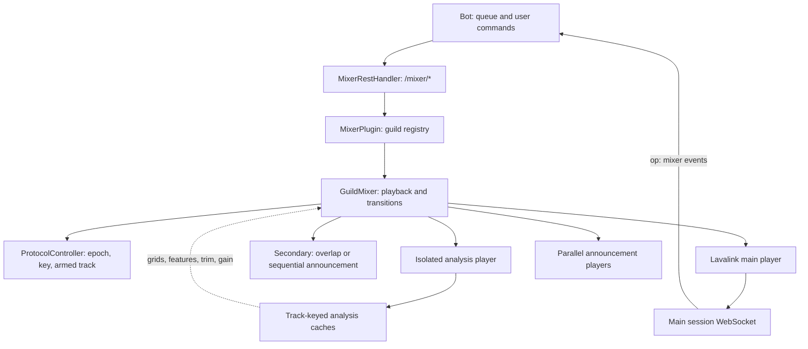
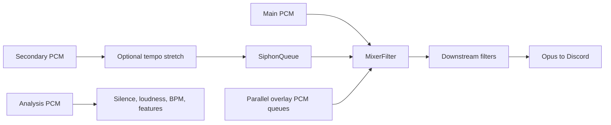
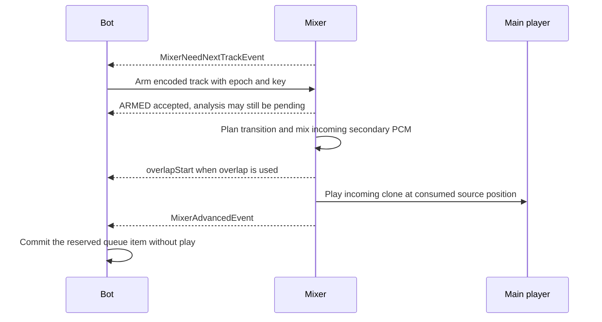

# lavalink_mixer

[English](README.md) | [한국어](README.ko.md)

[](https://github.com/mochilabs/lavalink_mixer/releases/latest)
[](UNLICENSE)
[](https://github.com/lavalink-devs/Lavalink)
[](https://adoptium.net)

A Kotlin plugin for [Lavalink v4](https://github.com/lavalink-devs/Lavalink) that mixes audio on the server before Opus encoding.

- Equal-power crossfades and server-managed advancement without overlap.
- An adaptive transition planner that picks one of seven strategies per track pair: phrase-matched or short bass swap, beat-matched blend, downbeat cut, echo out, filter sweep, or a plain crossfade.
- Beat matching with 2- to 16-beat fades, temporary tempo adjustment, and recovery to the incoming track's original speed.
- Bass swaps on a matched 4th-order Linkwitz-Riley crossover, so the two low ends trade places without comb filtering.
- Transition memory that avoids repeating the same strategy back to back in a guild.
- Leading and trailing silence trimming, plus realtime tail-silence detection.
- EBU R128 loudness measurement and attenuation toward a configurable target, defaulting to -14 LUFS.
- Sequential or parallel announcement audio with music ducking and stereo-channel selection.
- Protocol v2 queue coordination with epochs and idempotency keys.

The plugin requires no Lavalink source changes. Analysis runs in Kotlin/JVM on a separate decoder. Tempo stretching uses the host's `lavadsp` native support and falls back to unstretched PCM if native processing fails. Lavalink, Lavaplayer, and lavadsp are supplied by the server.

## Documentation

- [REST and WebSocket reference](api/openapi.yaml)
- [Bot integration guide](examples/lavalink-client/README.md)
- [Detailed bot integration guide in Korean](examples/lavalink-client/README.ko.md)
- [Architecture and threading](docs/architecture.md)
- [Build and testing guide](docs/development.md)
- [BPM detector design](docs/bpm-detector-design.md) and [BPM calibration](docs/bpm-calibration.md)
- [BPM extraction algorithm explained in Korean](docs/bpm-extraction.ko.md)
- [Adaptive transition calibration](docs/adaptive-calibration.md)

## Quickstart

### 1. Install the plugin

Download `lavalink_mixer-<version>.jar` from [Releases](https://github.com/mochilabs/lavalink_mixer/releases), place it in Lavalink's `plugins/` directory, and restart Lavalink. You can also [build the JAR locally](#build-from-source).

Check `GET /mixer/info` with Lavalink's `Authorization` header to confirm the plugin loaded. It returns the running JAR version, `protocolVersion: 2`, and supported position options.

This checkout compiles against Lavalink plugin API 4.2.2, Lavaplayer 2.2.6, and lavadsp 0.7.8, targeting JVM 17. Use a compatible Lavalink server.

### 2. Enable the filter for each player

Before playback, use Lavalink v4's [Update Player endpoint](https://lavalink.dev/api/rest#update-player):

```http
PATCH /v4/sessions/{sessionId}/players/123456789012345678
Authorization: <Lavalink password>
Content-Type: application/json

{
	"filters": {
		"pluginFilters": {
			"mixer": {
				"guildId": "123456789012345678"
			}
		}
	}
}
```

Use the Lavalink session ID from the WebSocket `ready` message. Updating `filters` replaces the player's filter configuration, so include any other filters you need and retain `pluginFilters.mixer` on later updates. Reapply it when creating a replacement player.

Keep guild IDs as JSON strings. Discord snowflakes can exceed JavaScript's safe integer range. The mixer routes use `/mixer/*` on the same server, without the `/v4` prefix.

### 3. Connect the bot's queue handling

Start the first track through your Lavalink client and disable client auto-advance, such as `autoSkip: false` in lavalink-client. Forward custom `op: "mixer"` WebSocket messages to your bot handler.

On `MixerNeedNextTrackEvent`, arm the next track through `/mixer/queue/arm`. On `MixerAdvancedEvent`, update the bot's queue and now-playing state. The server has already started that track. Client `trackEnd` handlers must also leave advancement to the server.

Implement the [protocol v2 flow](#queue-protocol-v2) before relying on automatic transitions. Enabling the filter alone does not provide a next track.

## Server defaults

Set startup defaults in Lavalink's `application.yml` under `mixer:`:

```yaml
mixer:
  # Crossfade and initial fade-in
  crossfadeEnabled: true
  crossfadeMs: 5000
  fadeInMs: 300

  # Announcement ducking and concurrency
  duckLevel: 0.2
  duckFadeMs: 300
  maxParallelOverlays: 4

  # Loudness normalization
  normalizationEnabled: false
  targetLufs: -14.0

  # Silence trimming
  silenceSkipEnabled: false
  silenceThresholdDb: -60.0
  silenceMinSoundMs: 120
  silenceHeadScanMs: 15000
  silenceTailScanMs: 15000
  tailConfirmMs: 1000

  # BPM detection and beat matching
  bpmDetectionEnabled: false
  bpmScanMs: 30000
  keyDetectionEnabled: false
  keyScanMs: 30000
  beatmatchEnabled: false
  maxTempoChange: 0.06
  beatmatchMinConfidence: 0.30

  # Shared analysis worker pool
  analysisThreads: 2
```

Per-guild REST endpoints override the settings listed in the [API tables](#rest-api). Worker count, ducking-ramp duration, and the parallel-overlay limit have no dedicated REST setter. `analysisThreads` is clamped to 1–8, and `maxParallelOverlays` to 1–16.

Crossfade defaults to enabled. Silence trimming, normalization, and BPM detection default to disabled because analysis requires extra decoding. Beat matching also defaults to disabled.

## Transitions and audio processing

### Enable beat matching

Beat matching requires crossfade, BPM detection, and beat matching all enabled. `/mixer/bpm` can enable detection and matching together:

```http
POST /mixer/bpm
Authorization: <Lavalink password>
Content-Type: application/json

{
	"guildId": "123456789012345678",
	"enabled": true,
	"beatmatchEnabled": true,
	"scanMs": 30000,
	"maxTempoChange": 0.06,
	"minConfidence": 0.30
}
```

`/mixer/beatmatch` toggles matching independently and does not enable BPM detection. If crossfade was disabled, enable it through `/mixer/crossfade` as well.

### How a transition is chosen

Analysis extracts head and tail beat grids (tempo, beat phase, downbeat and phrase confidence) and local transition features (energy, rhythm stability, key). `AdaptiveTransitionPlanner` turns them into one declarative recipe per track pair, trying the most precise strategy first and degrading when the evidence is weaker:

| Situation | Strategy | Wire `transitionKind` |
| --- | --- | --- |
| Tempos compatible, downbeats and phrases confident | `PHRASE_MATCHED_BASS_SWAP`: up to a 16-beat fade, bass swapped at the fade midpoint | `beat_matched` |
| Tempos compatible, downbeats confident | `SHORT_BASS_SWAP`: up to an 8-beat fade with a bass swap | `beat_matched` |
| Tempos compatible, bar boundaries uncertain or non-4/4 | `BEATMATCHED_BLEND`: 2-, 4-, or 8-beat phase-snapped fade | `beat_matched` |
| Tempos too far apart, both downbeats confident, high energy | `DOWNBEAT_CUT`: 10 ms cut on a bar line | `crossfade` |
| Tempos too far apart otherwise | `ECHO_OUT`: delayed echo of the outgoing track, up to 2 s | `crossfade` |
| No usable grid, but valid features | `DEGRADED_FILTER_SWEEP`: high-pass sweep, up to 4 s | `crossfade` |
| No usable metadata, or no beat count fits `crossfadeMs` | `ABSOLUTE_FALLBACK`: equal-power crossfade | `short_crossfade` |

Tempo comparison is octave-normalized (half and double time count as a match) and uses a deadband around `maxTempoChange`; inside the deadband, energy, rhythm, and key compatibility decide. Fade length never exceeds `crossfadeMs` minus the recovery period. When no 2-, 4-, 8-, or 16-beat fade fits, the planner uses a plain equal-power crossfade of the configured length (`fade_window_too_short`). A `crossfadeMs` of zero or less produces no overlap.

During a matched transition the incoming track follows the outgoing tempo, then recovers to its original speed before handoff. `overlapMs` is the two-track fade duration, and `recoveryMs` is the incoming-only recovery period within the total transition window.

When two strategies are close, transition memory penalizes the ones used most recently in that guild, so consecutive transitions vary. A clear planner preference always wins.

If a track has a measurable pulse at only one end, the plugin re-measures the other end near that tempo, and otherwise projects the tempo with beat phase moved into the target window. Downbeat and phrase stay unverified in that case, so such a track cannot use a bass swap or downbeat cut.

If analysis for the incoming track is still running when the fade window opens, the mixer waits up to 2 seconds, then plans with whatever is cached. A fade that starts late is compressed so the outgoing track still reaches silence at the planned handoff. Native tempo-stretch failures fall back to an ordinary crossfade.

Confidence values and thresholds are heuristics that await calibration on representative music. See the [BPM design notes](docs/bpm-detector-design.md) for detector details and limits.

### Crossfade, silence, and normalization

Crossfades use equal-power gains and soft limiting above an absolute mixed amplitude of `0.9`. Handoff position follows consumed incoming source samples, including tempo adjustment, rather than the secondary decoder's buffered position.

Silence analysis scans seekable tracks near their start and end. Realtime detection monitors raw main PCM before gain application. For tracks with a known duration, an early cut requires confirmed silence in the tail window after the first five seconds. Streams require at least `max(tailConfirmMs, 3000)` ms of silence. Advancement uses an armed next track when available.

Normalization uses K-weighting, 400 ms windows with 75% overlap, and absolute and relative loudness gates. Gain is capped at `1.0`, so quiet tracks are not amplified. The target is configurable from -30 to -6 LUFS through REST. A provisional estimate from the first 8 seconds of decoded audio applies before the full-track measurement finishes. Gain changes from late results ramp over one second. A track whose loudness is not known yet keeps the previous track's level instead of starting at unity. `currentTrackGain` reports the level the current track is playing at or ramping toward.

### Announcements

`POST /mixer/announce` accepts an encoded track or a source identifier. It plays supplied audio, including audio from a TTS source configured on the server. The plugin does not synthesize speech itself.

Sequential announcements share the secondary player with crossfades and wait when it is busy. Parallel announcements use separate players, up to `maxParallelOverlays`. Both modes support `channel: "both"`, `"left"`, or `"right"` and duck the main track. Announcements also play when the main player has no track. The plugin then plays an internal endless silent track (identifier `lavalink-mixer:idle-carrier`, URI `mixer://idle-carrier`, `isStream: true`) so the filter chain runs, and stops it about one second after the last announcement ends. Lavalink forwards that track's `TrackStartEvent` and `TrackEndEvent` (end reason `stopped`) to the client and a plugin cannot suppress them, so a bot must ignore events whose track identifier is `lavalink-mixer:idle-carrier` and must not treat it as a queue item. A track the bot plays replaces the carrier. A bot that plays with `noReplace=true` while the carrier runs is ignored by Lavalink, so stop or leave out `noReplace` when the guild may be announcing. The announcement needs a connected voice channel and an unpaused player. `/mixer/announce/cancel` stops the active sequential announcement. Clear waiting items separately with `DELETE /mixer/announce/queue?guildId=...`.

## Queue protocol v2

The bot owns queue selection. After initial playback starts, the plugin owns advancement to the armed track.

1. The server sends `MixerNeedNextTrackEvent` in the prefetch window.
2. The bot sends `/mixer/queue/arm` with the exact Lavalink-encoded next track, an epoch, and an `Idempotency-Key`. Send `isEmpty: true` if the queue is empty.
3. The server accepts the arm and schedules analysis. `ARMED` means the track was accepted, not that analysis finished.
4. The server performs the transition and sends `MixerAdvancedEvent` with `handoffType: "CROSSFADE"` or `"GAPLESS"`.
5. The bot synchronizes its local queue without starting the same track again.

The prefetch window is `crossfadeMs + 7000` ms. With BPM detection and beat matching enabled, it becomes `crossfadeMs + min(2 * bpmScanMs + 7000, 120000)` ms. Short tracks have a 500 ms settle delay, and reset grace can delay dispatch further.

Use a new key for each logical operation and reuse that key when retrying the same request. The server retains 64 recent operation fingerprints per guild in memory. A retained match returns a duplicate response, while a mismatch returns HTTP 422. Lower epochs return HTTP 409 for new requests; equal epochs are accepted. Reset, eviction, and process restart limit deduplication.

If the queue head changes, send `/mixer/queue/invalidate` with a higher epoch and a new key. This clears the armed slot and can request the next track again within the prefetch window. Explicit skips and stops use `/mixer/queue/override` with `PLAY_NOW` or `STOP`. Player mutation runs on an ordered executor. Confirm execution through `MixerOverriddenEvent`.

On bot startup or session resume, call `/mixer/reset` to synchronize epochs. Reset keeps the greater of the existing and supplied epochs and opens a 1500 ms grace window by default. Handle HTTP 409 using `lastKnownEpoch` and, for `PRE_RESET_ARRIVAL`, `windowOpenAt`.

### Preserve transitions and skip track boundaries

An arm request can include these optional fields:

| Field | Behavior |
| --- | --- |
| `preserveTransition` | Preserves this track boundary without automatic overlap or silence trimming. Applies to one arm, not a persistent album mode. |
| `startPositionMs` | Minimum incoming start position, applied before overlap or gapless playback, including preserved transitions. A nonzero value requires a seekable track with more than 500 ms remaining. |
| `outgoingEndPositionMs` | Effective end of the current track. The fade finishes there, or advancement occurs there without overlap. Requires a seekable current track, a non-empty next track, and `preserveTransition: false`. |

Check `/mixer/info` for `incomingStartPositionSupported` and `outgoingEndPositionSupported` on each node. Both position fields are milliseconds and participate in arm deduplication. Do not send either position field with `isEmpty: true`. An outgoing cutoff must be more than 500 ms from each track boundary. A cutoff already passed or within 500 ms of the current position when armed is ignored.

These options let a bot supply intro or outro boundaries, such as SponsorBlock segments. Segment lookup and selection belong to the bot. `overlapStart.incomingStartMs` reports the actual incoming position selected for an overlap.

## REST API

All endpoints use Lavalink's raw password in the `Authorization` header, without a `Bearer` prefix. All JSON guild IDs are strings. See [OpenAPI](api/openapi.yaml) for exact schemas, responses, and numeric bounds. Optional configuration fields preserve their current values when omitted; supplied numbers are clamped to documented bounds.

### Queue and playback

The four queue-control operations below require `Idempotency-Key`.

| Method | Path | Request | Result |
| --- | --- | --- | --- |
| `GET` | `/mixer/info` | None | Running version, protocol version, and incoming/outgoing position capabilities |
| `GET` | `/mixer/state?guildId=...` | Query guild ID | State, settings, analysis, gains, BPM, key estimates, and transition diagnostics |
| `POST` | `/mixer/analyze` | `{ guildId, encodedTrack }` | HTTP 202 with `accepted`; cache warmup does not arm or start playback |
| `POST` | `/mixer/queue/arm` | `{ guildId, epoch, encodedTrack?, isEmpty?, preserveTransition?, startPositionMs?, outgoingEndPositionMs? }` | Accept next track or empty queue |
| `POST` | `/mixer/queue/invalidate` | `{ guildId, epoch }` | Clear armed track and optionally re-request next track |
| `POST` | `/mixer/queue/override` | `{ guildId, epoch, action, encodedTrack? }` | Schedule `STOP` or `PLAY_NOW`; the latter requires a track |
| `POST` | `/mixer/reset` | `{ guildId, epoch, windowOpenGraceMs? }` | Synchronize epoch and clear pending transition state |

### DSP settings and announcements

These endpoints do not require `Idempotency-Key`.

| Method | Path | Request |
| --- | --- | --- |
| `POST` | `/mixer/crossfade` | `{ guildId, enabled, durationMs? }`, duration 500–30000 ms |
| `POST` | `/mixer/fade-in` | `{ guildId, durationMs }`, duration 0–10000 ms |
| `POST` | `/mixer/bpm` | `{ guildId, enabled, scanMs?, beatmatchEnabled?, maxTempoChange?, minConfidence? }` |
| `POST` | `/mixer/key` | `{ guildId, enabled, scanMs? }` |
| `POST` | `/mixer/beatmatch` | `{ guildId, enabled, maxTempoChange?, minConfidence? }` |
| `POST` | `/mixer/silence` | `{ guildId, enabled, thresholdDb?, minSoundMs?, headScanMs?, tailScanMs?, tailConfirmMs? }` |
| `POST` | `/mixer/normalization` | `{ guildId, enabled, targetLufs? }` |
| `POST` | `/mixer/announce` | `{ guildId, identifier?, encodedTrack?, duckLevel?, mode?, channel? }`, HTTP 202 |
| `POST` | `/mixer/announce/cancel` | `{ guildId }` |
| `DELETE` | `/mixer/announce/queue?guildId=...` | Query guild ID |

## WebSocket events

Consume these custom messages on the existing Lavalink WebSocket connection:

```jsonc
// Arm the next track when requested.
{ "op": "mixer", "type": "MixerNeedNextTrackEvent", "guildId": "123", "remainingMs": 12000, "currentTrackEncoded": "..." }

// A beat-matched overlap starts, including its incoming-only recovery period.
{ "op": "mixer", "type": "overlapStart", "guildId": "123", "crossfadeMs": 4500, "overlapMs": 4000, "recoveryMs": 500, "handoffInMs": 4500, "incomingStartMs": 13520, "beatMatched": true, "fadeBeats": 8, "targetBpm": 120.0, "rateRatio": 1.016, "transitionKind": "beat_matched", "track": { "identifier": "next-track", "title": "Next track" } }

// Sync the local queue. Playback has already advanced.
{ "op": "mixer", "type": "MixerAdvancedEvent", "guildId": "123", "epoch": 2, "encodedTrack": "...", "handoffType": "CROSSFADE", "handoffId": "550e8400-e29b-41d4-a716-446655440000" }

{ "op": "mixer", "type": "overlapEnd", "guildId": "123", "reason": "handoff", "beatMatched": true }
{ "op": "mixer", "type": "MixerOverriddenEvent", "guildId": "123", "epoch": 3, "requestId": "key", "action": "PLAY_NOW" }

// Parallel announcement lifecycle.
{ "op": "mixer", "type": "announceStart", "guildId": "123", "announcementId": 1, "mode": "parallel", "track": { "identifier": "notice", "title": "Notice" } }
{ "op": "mixer", "type": "announceEnd", "guildId": "123", "announcementId": 1 }
```

`handoffId` applies to crossfade advancement. Aborted overlaps use `reason: "aborted"`. A native tempo-stretch failure after `overlapStart` can make `overlapEnd` report `beatMatched: false` with `fallbackReason: "timescale_native_failed"`. Sequential `announceEnd` events omit `announcementId`.

## Inspect playback

Each started crossfade writes one INFO line with `beatMatched`, the decision or
fallback reason, both tracks' BPM/key estimates and confidence, analysis windows,
RMS energy, rhythm stability, the selected strategy, and the tempo ratio and fade beats.
The line names the BPM/key analysis methods and the confidence/tempo limits used
by the planner. Missing and ambiguous measurements remain explicit. Confidence
scores are heuristic, and keys describe the sampled windows.

Progress, secondary-buffer starvation, late-start details, and handoff diagnostics
use DEBUG. Transition aborts and playback failures retain their warning logs.
See [console diagnostics](docs/development.md#read-transition-logs) for fields and
the DEBUG setting.

Use `GET /mixer/state?guildId=...` while testing:

- Check `mixerFilterActive`, `nextTrackIdentifier`, and `subTrackIdentifier` when overlap audio is missing.
- Check `state`, `lastKnownEpoch`, `hasNext`, and `analysisState` when queue ownership or analysis appears stalled. `analysisState` reflects an active scan or the next-track slot. `ready` does not guarantee that BPM grids are available.
- Check `transitionKind`, `decisionReason`, and `crossfadeHandoffInMs` for the latest transition decision and active handoff timing. `beat_matched` describes a selected plan, so also inspect completion events for fallback.
- Check `currentTrackBpmIdentifier` against the confirmed current track before displaying `currentTrackBpm`. BPM and gain values can be unknown while analysis is pending or disabled.

`POST /mixer/analyze` optionally warms enabled silence and BPM/feature caches for a seekable candidate. HTTP 202 does not mean analysis is complete. Normalization analysis still occurs through normal arming. Analysis remains separate from live secondary playback.

## Musical key estimation

Enable key analysis independently of BPM and beat matching:

```http
POST /mixer/key
Content-Type: application/json

{"guildId":"123456789012345678","enabled":true,"scanMs":30000}
```

`GET /mixer/info` advertises `keyDetectionSupported: true`. Read
`currentTrackKey` and `nextTrackKey` from `/mixer/state`:

```json
{"type":"estimated","identifier":"track-id","windowStartMs":0,"windowEndMs":30000,"key":"G","scale":"minor","confidence":0.7}
```

Compare each result's `identifier` with the bot's confirmed track before
showing it. A null result means disabled, pending, absent, or unsupported.
An inconclusive scan returns `type: "unknown"` with a `reason`, such as
`silence` or `ambiguous_key`. Unknown results are cached and do not keep retrying.

Analysis uses a separate decoder for a bounded head window of a seekable,
known-length track. `scanMs` defaults to 30000 and is clamped to 5000–60000 ms.
Compatible BPM head scans share decoded PCM. `/mixer/analyze` also supports
key-only warmup without arming playback. The cache is keyed by track identifier;
changing `scanMs` does not invalidate an existing result.

The result describes the sampled window. Modulation, relative major/minor keys,
and non-tonal audio can make the estimate ambiguous. Confidence is a heuristic
score, not a calibrated probability. Real-music accuracy remains uncalibrated.

Transitions prepare the secondary decoder up to two seconds before the fade.
They wait off the shared scheduler for captured PCM before reducing main gain.
If preparation runs late, the fade uses the remaining time until handoff without
discarding the incoming opening to catch up. Without usable PCM, the original
queued track remains available for gapless advancement.

---

## Architecture

The bot selects queue items. The plugin controls transitions after the first
track starts. Each guild has a mixer, a protocol controller, a secondary player,
and an isolated analysis path. Parallel announcements have separate players.



### PCM path and analysis isolation



Only the main player feeds Discord. The secondary capture queue carries both PCM
and source-progress accounting. Analysis PCM stays on a separate player and queue;
only its measurements influence planning and gain. Sequential announcements share
the secondary player with overlap, while parallel announcements have their own queues.

### Handoff and queue synchronization



The main player stays in place at handoff. The plugin clones the incoming track
and seeks from its start position plus consumed source samples. Decoder position
can run ahead because of buffering, and tempo-adjusted source progress differs
from output duration. This distinction prevents a handoff from seeking to audio
that was decoded but has not been heard.

| Concern | Responsible component |
| --- | --- |
| Full queue, repeated-track identity, user selection | Bot |
| Armed next slot, epoch checks, JIT requests | `ProtocolController` and `EpochGate` |
| Secondary playback, transition plan, gains, overlays | `GuildMixer` |
| Background measurements and shared caches | `TrackAnalysisService` and `AnalysisCaches` |
| PCM gains, mixing, downstream forwarding | `MixerFilter` |

### Threading and replacement players

The scheduler pumps secondary output every 20 ms and polls transitions every
fifth tick. Analysis uses a shared worker pool; protocol actions use a per-guild
ordered executor. Audio and player callbacks also access mixer state.

The audio callback mixes PCM and forwards it downstream. Track loading, analysis,
and blocking waits run elsewhere. A bounded sample queue handles decoder chunk
sizes, with zero-filled underflow and bounded overflow.

The guild state lock protects transition decisions, while `playerMutationLock`
serializes main-player changes. Player changes release the state lock and recheck
epochs, sequence numbers, and identity before committing. The filter looks up its
guild mixer on each chunk so replacement players can use the current instance.
Feeder election lets only one filter chain advance shared gains and secondary PCM.

The [architecture reference](docs/architecture.md) includes execution-context,
lock-order, audio-flow, and protocol-state charts. The
[detailed integration guide](examples/lavalink-client/README.ko.md) covers queue
reservations, duplicate events, retry recovery, reconnects, and boundary options.

## Build from source

Use JDK 17 to match CI. This checkout uses Kotlin 2.1.20 and the Gradle 8.14.1 wrapper. Initial dependency resolution needs Maven Central and `maven.lavalink.dev`.

```bash
# Compile, run tests, and package the plugin.
./gradlew build

# Package without running tests.
./gradlew jar

# Set an explicit artifact version.
./gradlew build -Pversion=1.2.3
```

JARs appear in `build/libs/lavalink_mixer-<version>.jar`. Version resolution uses `MIXER_VERSION`, then `-Pversion`, then an exact Git tag, then `0.0.0-SNAPSHOT`. A leading `v` is removed. `/mixer/info` reports the version embedded in the running JAR.

See the [development guide](docs/development.md) for focused tests and live validation. Local audio integration tests exercise Lavaplayer with generated WAV files. They do not prove playback through a live Discord voice connection.

## License

Released into the public domain under the [Unlicense](UNLICENSE).
