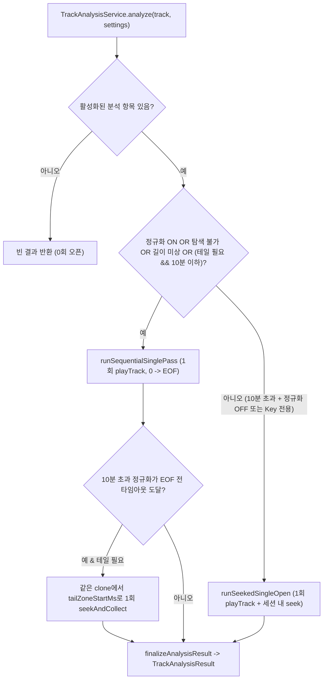

# 단일 패스 분석 파이프라인 (Single-Pass Analysis Pipeline)

이 문서는 `TrackAnalysisService`, `SiphonQueue`, `GuildMixer`가 무음 구간 트림, EBU R128 음량, 비트 그리드, 전환 특성, 조성(Key) 추정을 추출하면서 **트랙당 소스 오픈을 최대 1회로 제한하는 방식**을 설명합니다.

플러그인 전체 구조는 [아키텍처 레퍼런스](architecture.ko.md)를 참고하세요. 영문 문서는 [analysis-pipeline.md](analysis-pipeline.md)입니다.

## 왜 단일 오픈이 중요한가요?

`AudioPlayer.playTrack(clone)`를 호출할 때마다 소스 매니저의 `AudioTrack.process(...)`가 실행됩니다. 로컬 파일에서는 부담이 적지만, 캐시되지 않은 YouTube 같은 원격 스트림에서는 분석 패스를 여러 번 열 때마다 스트림 매니페스트 요청과 HTTP range 연결이 반복되어 대기 시간, 대역폭 소모, 403/429 또는 봇 감지 위험이 함께 올라갑니다.

이전 구조에서는 30초보다 긴 트랙을 분석할 때 음량·앞무음·뒷무음·앞 BPM·BPM 스마트 재시도·뒤 BPM·조성 단계마다 트랙을 최대 7번 새로 열었고, 재생 중인 곡 백필(최대 3회)과 실패 시 250ms 간격 재시도(최대 3회)까지 겹쳐 요청 수가 불어났습니다.

현재 분석 파이프라인은 다음 **단일 오픈 원칙**을 강제합니다.

1. `TrackAnalysisService.analyze(...)`는 `sub.playTrack(clone)`를 **최대 1회**만 호출합니다.
2. `GuildMixer`의 메인 트랙 시작 핸들러는 기준 음량 스캔과 프리분석(BPM/무음/조성)을 하나의 작업으로 합칩니다.
3. `GuildMixer.backfillPlayingTrack`은 현재 재생 중인 곡에 누락된 모든 항목(`bpm`, `norm`, `trim`, `key`)을 `analyze(...)` 1회로 묶어 채웁니다.
4. `GuildMixer.requestPreanalysis`는 10분 이하 순차 스캔 시 음량까지 함께 계산·캐시해 이후 `arm` 단계의 재오픈을 없앱니다.
5. `AnalysisState`는 실패 재시도를 **5초 쿨다운 후 최대 1회**로 제한하고, 디코더가 정상 EOF에 도달했다면 컨테이너 메타데이터 길이와의 미세 오차(`2000 ms`)로 `incomplete_window` 재시도를 반복하지 않습니다.

---

## 하이브리드 단일 오픈 동작 흐름

### 모드 1: 순차 스트리밍 단일 패스 (`runSequentialSinglePass`)

`normalization == true`이거나, 탐색 불가/길이 미상 스트림이거나, `SEQUENTIAL_MAX_MS`(`600_000 ms`, 10분) 이하 트랙에서 앞/뒤 분석이 필요한 경우 실행합니다.

긴 트랙의 전체 Float PCM을 힙에 적재하지 않고, 채널당 최대 1,920샘플 청크를 스트리밍 소비자에게 흘려 1패스로 처리합니다.

| 소비자 | 메모리 사용량 | 동작 방식 |
| --- | --- | --- |
| `LoudnessMeter` | $O(1)$ 누적기 | `normalization == true`일 때 디코딩된 모든 샘플을 누적하며, `PROVISIONAL_LOUDNESS_MS`(`8000 ms`) 시점에 임시 LUFS를 보고합니다. |
| `SilenceAnalyzer.LeadScanner` | $O(1)$ 스캐너 | 첫 유음 구간을 확정하거나 `silenceHeadScanMs`에 도달할 때까지만 입력을 소비합니다. |
| `headFrames` | `max(bpmScanMs, keyScanMs)` 상한 | 앞쪽 윈도를 채우면 추가 적재를 중단합니다. |
| 스마트 재시도 캡처 | `bpmScanMs + 2000 ms` 상한 | `headFrames`가 채워진 즉시 신뢰도를 검사해 `bpmMinConfidence` 미만이면 약 25% 지점(`[max(min(duration / 4, 60_000), lead), +scanMs+2s]`)을 지나갈 때 인라인으로 캡처합니다. |
| `TailRingBuffer` | 링 버퍼 (`silenceTailScanMs + bpmScanMs + 4000 ms`) | 전역 샘플 오프셋과 함께 끝쪽 구간만 유지하고 오래된 앞부분 청크는 즉시 버립니다. |

정상 EOF에 도달하면 다음 순서로 결과를 산출합니다.
- 끝 무음(`trailMs`)은 `TailRingBuffer`의 마지막 `silenceTailScanMs` 슬라이스로 계산합니다.
- 테일 BPM과 전환 특성은 `TailRingBuffer`에서 `[duration - trailMs - bpmScanMs .. +2000 ms]` 범위를 잘라 분석합니다.
- **네트워크 효율**: 일반적인 3~10분 트랙은 seek 없이 순차로 읽히므로 단일 HTTP 스트림 내에서 완료되는 경우가 많으며, 스트림 캐시 플러그인(예: 파일 캐시) 사용 시 1패스 완주로 전체 트랙 캐시까지 완성됩니다.

10분을 초과하는 트랙에서 `normalization == true`를 실행하다가 `SCAN_TIMEOUT_MS + LOUDNESS_GRACE_MS` 제한에 도달해 EOF 전에 멈춘 경우, 같은 `clone`을 닫지 않고 `seekAndCollect`로 끝 구간만 1회 점프해 테일 무음/BPM을 마저 회수합니다.

### 모드 2: 세션 내 Seek 단일 오픈 (`runSeekedSingleOpen`)

`SEQUENTIAL_MAX_MS`(10분)를 초과하면서 `normalization == false`인 탐색 가능 트랙, 또는 곡 전체를 읽을 필요가 없는 `key` 단독 분석에서 사용합니다.

1. 위치 `0`에서 `sub.playTrack(clone)`을 **1회** 시작합니다.
2. `max(silenceHeadScanMs, bpmScanMs, keyScanMs)`까지 앞 구간을 수집합니다.
3. `weakHead` 재시도가 필요하면 **같은 `clone`** 안에서 `retryStartMs`로 `seekAndCollect`를 호출합니다.
4. 끝 무음 또는 테일 BPM이 필요하면 `earliestTailSeekMs(duration, settings)`로 **1회만** `seekAndCollect`하여 EOF까지 한 번에 읽어 끝 무음과 테일 BPM/특성을 동시에 추출합니다.

#### 재생 중인 `SiphonQueue`에서 안전하게 Seek 동기화하기

Lavaplayer는 재생 중 `clone.position = targetMs`를 설정할 때 비동기로 탐색을 예약하므로, 탐색 직전 PCM이 `AudioFrameBuffer`와 `SiphonQueue`에 잠시 남아 있을 수 있습니다.

이전 구간 오디오가 탐색 이후 분석 윈도에 섞이지 않도록 다음과 같이 동기화합니다.

1. `SiphonQueue`는 원자적 `seekEpoch` 카운터를 유지합니다.
2. `SiphonFilter.seekPerformed(requestedTime, providedTime)`가 호출되면 `SiphonQueue.markSeekPerformed()`가 실행되어 탐색 전 PCM을 비우고 `seekEpoch`를 증가시킨 뒤 새 PCM을 받습니다.
3. `seekAndCollect`는 `beforeSeekEpoch`를 기록한 뒤 `clone.position = targetMs`를 호출하고, `tap.currentSeekEpoch() > beforeSeekEpoch`가 될 때까지 오래된 프레임을 폐기한 다음부터 분석 프레임을 수집합니다.

---

## 길드 수명주기 및 재시도 보호 장치

### 프리분석 예열과 장전 재사용 (`requestPreanalysis`)

- `shouldWarmNormFor(track)`는 `normalizationEnabled`가 켜져 있고 `silenceSkipEnabled` 또는 `bpmDetectionEnabled` 중 하나 이상이 활성화되어 있으며 `duration <= SEQUENTIAL_MAX_MS`인 트랙에 대해 `requestPreanalysis`가 음량까지 함께 계산하도록 허용합니다.
- 어차피 순차 1패스가 `0 -> EOF`를 모두 읽으므로 추가 I/O 비용 없이 `AnalysisCaches.norm`이 채워지며, 이후 `arm` 시점에 트랙을 다시 열지 않습니다.
- `analyzeBlocking(track, cacheOnly = true)`를 직접 호출하는 경로는 기존 계약대로 `includeNormalization = !cacheOnly`(`false`)를 유지합니다.

### 메인 트랙 시작 및 백필 통합

- **메인 트랙 시작**: 정규화와 BPM/조성/무음 분석이 함께 켜져 있으면 기준 음량 스캔과 프리분석을 하나의 `requestPreanalysis(clone, includeNormalization = needsBaselineAnalysis)`로 통합 실행합니다. 정규화만 단독으로 켜졌거나 탐색 불가능한 트랙만 기존 `scheduleBaselineAnalysis(track)` 경로를 탑니다.
- **`backfillPlayingTrack`**: 다음 곡 분석이 끝난 뒤 현재 메인 트랙에 누락된 지표(테일 BPM, 음량, 무음 트림, 조성)가 있으면 각각 따로 스캔하지 않고 **1회의 `analysisService.analyze(playing, ...)` 호출**로 통합 보충합니다.

### 보수적인 실패 재시도 및 EOF 오차 허용

- `TrackAnalysisService`는 `AudioEventAdapter`로 `AudioTrackEndReason.FINISHED` / `LOAD_FAILED`와 `onTrackException`을 추적합니다.
- `guardFeatureWindow`는 디코더가 정상 EOF에 도달했고 실제 디코딩 길이가 컨테이너 메타데이터 `duration` 대비 `METADATA_EOF_DRIFT_MS`(`2000 ms`) 이내라면 `incomplete_window` 실패로 취급하지 않습니다.
- `AnalysisState`는 실제 분석 실패 시 재시도를 `MAX_FAILURE_RETRIES = 1`, `FAILURE_RETRY_COOLDOWN_MS = 5_000L`로 제한하여 원격 소스 오류 시 반복 요청 폭주를 막습니다. (다른 곡 분석 중이라 밀린 정상 지연 재시도는 기존 `250 ms` 간격을 유지합니다.)
