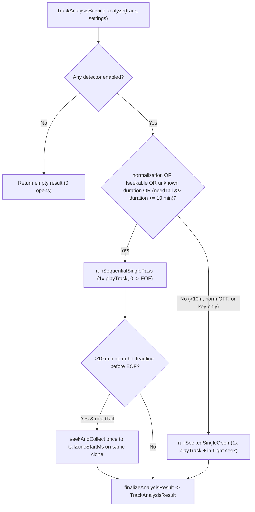

# Single-Pass Analysis Pipeline

This document describes how `TrackAnalysisService`, `SiphonQueue`, and `GuildMixer` extract silence trim points, EBU R128 loudness, beat grids, transition features, and musical key estimates while opening each source track **at most once per analysis pass**.

For how analysis fits into the rest of the plugin, see [the architecture reference](architecture.md). Available in [Korean](analysis-pipeline.ko.md).

## Why single-open analysis matters

Every `AudioPlayer.playTrack(clone)` invocation calls `AudioTrack.process(...)` on the track's source manager. On local files that cost is negligible, but on uncached remote sources such as YouTube each separate open can trigger a fresh player/manifest request and range stream, increasing latency, bandwidth usage, and rate-limit or bot-detection exposure.

Previously, analyzing a seekable track longer than 30 seconds could invoke up to seven separate `playTrack` opens across loudness, head silence, tail silence, head BPM, smart-retry BPM, tail BPM, and key estimation, plus up to three additional opens to backfill the currently playing track and up to three rapid retries on failure.

The analysis pipeline now enforces a **strict single-open contract**:

1. `TrackAnalysisService.analyze(...)` opens `sub.playTrack(clone)` **at most once**.
2. `GuildMixer.onMainTrackStart` combines baseline loudness and preanalysis into one scheduled scan.
3. `GuildMixer.backfillPlayingTrack` merges all missing metrics for the currently playing track (`bpm`, `norm`, `trim`, `key`) into one `analyze(...)` call.
4. `GuildMixer.requestPreanalysis` includes loudness during `<= 10 min` sequential scans so arming later requires zero additional opens.
5. `AnalysisState` bounds failure retries to **one retry after a 5 s cooldown**, and clean EOFs within metadata duration drift (`2000 ms`) do not trigger false `incomplete_window` retry loops.

---

## Hybrid single-open execution

### Mode 1: Sequential streaming single pass (`runSequentialSinglePass`)

Used whenever `normalization == true`, the stream is unseekable/unbounded, or tail metrics are needed on tracks up to `SEQUENTIAL_MAX_MS` (`600_000 ms` / 10 minutes).

Instead of buffering the entire track's float PCM in heap memory, chunks of up to 1,920 samples per channel flow through streaming consumers in one sequential decode:

| Consumer | Memory footprint | Lifecycle |
| --- | --- | --- |
| `LoudnessMeter` | $O(1)$ accumulator | Feeds every decoded sample when `normalization == true`; emits provisional LUFS at `PROVISIONAL_LOUDNESS_MS` (`8000 ms`). |
| `SilenceAnalyzer.LeadScanner` | $O(1)$ scanner | Feeds until sound is confirmed or `silenceHeadScanMs` completes. |
| `headFrames` | Bounded to `max(bpmScanMs, keyScanMs)` | Stops appending once the head window is covered. |
| Smart-retry capture | Bounded to `bpmScanMs + 2000 ms` | Evaluated right when `headFrames` finishes; if confidence `< bpmMinConfidence`, captures `[max(min(duration / 4, 60_000), lead), +scanMs+2s]` in stride as decoding passes ~25%. |
| `TailRingBuffer` | Bounded ring (`silenceTailScanMs + bpmScanMs + 4000 ms`) | Retains only the trailing audio window with exact global sample offsets; old chunks drop cleanly from the head. |

When decoding stops cleanly at EOF:
- Trailing silence is computed directly from the final `silenceTailScanMs` slice of `TailRingBuffer`.
- Tail BPM and transition features are sliced from `[duration - trailMs - bpmScanMs .. +2000 ms]` inside `TailRingBuffer`.
- **Network efficiency**: Standard 3–10 minute tracks typically remain under HTTP chunk limits (e.g., ~11.3 MiB), completing in a single sequential stream without mid-stream range re-requests—and allowing stream caches to finish caching the whole track cleanly.

If a >10-minute track runs with `normalization == true` and reaches the `SCAN_TIMEOUT_MS + LOUDNESS_GRACE_MS` wall-clock deadline before EOF, `runSequentialSinglePass` performs one in-flight `seekAndCollect` on the **same open `clone`** to retrieve tail metrics before stopping.

### Mode 2: In-flight seeked single open (`runSeekedSingleOpen`)

Used for seekable tracks longer than `SEQUENTIAL_MAX_MS` (10 minutes) with `normalization == false`, or for finite key-only scans where downloading the entire file is unnecessary.

1. Opens `sub.playTrack(clone)` **once** at position `0`.
2. Reads the head prefix up to `max(silenceHeadScanMs, bpmScanMs, keyScanMs)`.
3. If `weakHead` triggers smart BPM retry, executes `seekAndCollect` on the **same `clone`** to `retryStartMs`.
4. If `silence` or `bpm` tail metrics are needed, executes **one** `seekAndCollect` to `earliestTailSeekMs(duration, settings)` (capturing both trailing silence and tail BPM/features in a single tail read).

#### Seeking safely on an active `SiphonQueue`

In Lavaplayer, assigning `clone.position = targetMs` while playing sets an asynchronous seek request while pre-seek frames still live in the decoder's `AudioFrameBuffer` and `SiphonQueue`.

To prevent stale pre-seek audio from contaminating a post-seek analysis window:

1. `SiphonQueue` maintains an atomic `seekEpoch` counter.
2. `SiphonFilter.seekPerformed(requestedTime, providedTime)` calls `SiphonQueue.markSeekPerformed()`, clearing queued pre-seek PCM and bumping `seekEpoch` under the queue lock before post-seek PCM arrives.
3. `seekAndCollect` captures `beforeSeekEpoch`, sets `clone.position = targetMs`, pumps/drains stale frames until `tap.currentSeekEpoch() > beforeSeekEpoch`, and only then begins recording analysis frames.

---

## Guild lifecycle and retry safeguards

### Warmup & arming reuse (`requestPreanalysis`)

- `shouldWarmNormFor(track)` enables loudness measurement during `requestPreanalysis` automatically when `normalizationEnabled` is on, at least one full-pass detector (`silenceSkipEnabled` or `bpmDetectionEnabled`) is active, and the track is seekable with `duration <= SEQUENTIAL_MAX_MS`.
- Because sequential 1-pass already decodes `0 -> EOF`, caching `AnalysisCaches.norm` during warmup adds zero extra I/O and eliminates the second track open previously triggered at `arm()` time.
- Calling `analyzeBlocking(track, cacheOnly = true)` directly preserves its explicit `includeNormalization = !cacheOnly` (`false`) contract.

### Unified main-track startup & backfill

- **`mainListener.onTrackStart`**: Schedules one combined scan (`requestPreanalysis(clone, includeNormalization = needsBaselineAnalysis)`) when BPM, key, or silence detection is active alongside normalization, falling back to `scheduleBaselineAnalysis(track)` only when normalization is enabled alone or the track is unseekable.
- **`backfillPlayingTrack`**: When an incoming track finishes analysis and the currently playing main track still lacks tail BPM, loudness, trim points, or key, all missing flags are folded into **one** `analysisService.analyze(playing, ...)` call.

### Conservative failure retries & EOF drift tolerance

- `TrackAnalysisService` attaches an `AudioEventAdapter` to track `AudioTrackEndReason.FINISHED` vs `LOAD_FAILED` and `onTrackException` for the active scan clone.
- `guardFeatureWindow` accepts a clean EOF within `METADATA_EOF_DRIFT_MS` (`2000 ms`) of container-reported `duration` instead of marking the window as `incomplete_window` and triggering unnecessary re-scans.
- `AnalysisState` limits failure retries to `MAX_FAILURE_RETRIES = 1` with `FAILURE_RETRY_COOLDOWN_MS = 5_000L` (while keeping `DEFERRED_RETRY_THROTTLE_MS = 250L` for scans deferred only because another track held the analysis slot).
