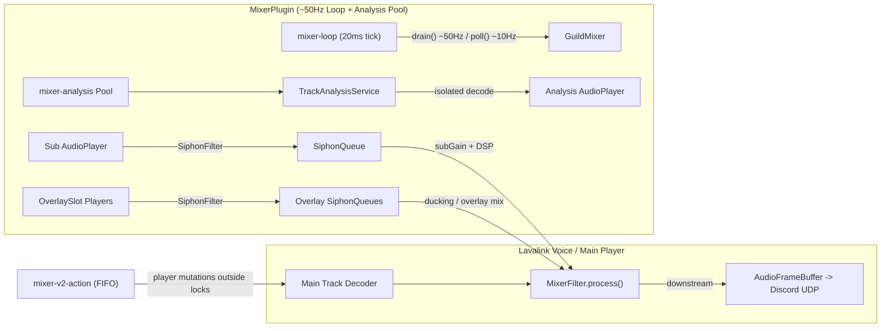
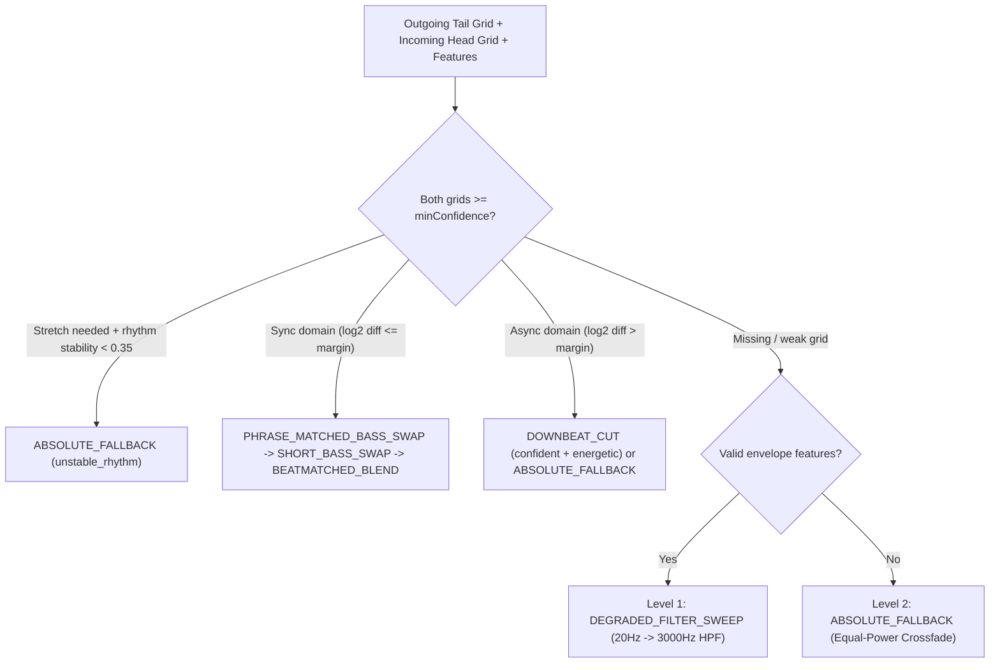

# 아키텍처 레퍼런스 (Architecture)

> English version: [architecture.md](architecture.md) · 단일 패스 분석 상세: [analysis-pipeline.ko.md](analysis-pipeline.ko.md)

이 문서는 `lavalink_mixer`의 런타임 경계, 스레드/락 소유권, PCM 믹싱 파이프라인, Protocol v2 제어 평면, 단일 오픈(single-open) 분석 엔진 및 Adaptive Automix 설계를 정리합니다. 코드 변경 없이 현재 구현된 계약과 불변식을 기준으로 서술합니다.

---

## 런타임 경계

`lavalink_mixer`는 Spring Boot 기반 Lavalink v4 서버 내부에서 `AudioFilterExtension`, REST `@RestController`, `PluginEventHandler`로 동작하는 플러그인입니다 (`plugin-api 4.2.2`, `Lavaplayer 2.2.6`, `lavadsp 0.7.8`, Kotlin `2.1.20`, JVM `17`).

| 경계 | 담당 클래스 | 역할 |
| --- | --- | --- |
| 필터 확장 | `MixerFilterExtension`, `MixerFilter` | 길드 메인 플레이어의 PCM 필터 체인에 믹싱 포인트 삽입 (`pluginFilters.mixer`) |
| 플러그인 코어 & 스케줄러 | `MixerPlugin`, `GuildMixer` | 길드별 믹서 수명주기 관리, ~50Hz 2차 디코더 펌프 및 ~10Hz 크로스페이드 폴링 |
| HTTP / WebSocket 제어 평면 | `MixerRestHandler`, `MixerEvents`, `ProtocolController` | `/mixer/*` REST API 처리 및 `{op: "mixer"}` WebSocket 이벤트 송신 |
| 오프라인 분석 | `TrackAnalysisService`, `AnalysisCaches`, `SiphonQueue` | 실시간 재생과 격리된 전용 디코더로 무음·음량·BPM·조성·전환 특성 추출 |

---

## 시스템 소유권과 스레드 모델

### 실행 컨텍스트

| 스레드 / 풀 | 주기 · 성격 | 책임 |
| --- | --- | --- |
| `mixer-loop` (`ScheduledExecutorService`) | 단일 데몬 스레드, `20ms` (~50Hz) | 모든 활성 `GuildMixer`의 `drain()` 호출(서브·오버레이 디코더 프레임 회수) 및 `tick % 5 == 0` (~10Hz)마다 `poll()` 실행 |
| `mixer-analysis` | `config.analysisThreads.coerceIn(1, 8)` 크기의 스레드 풀 | `TrackAnalysisService.analyze(...)` 및 프리분석/백필 오프라인 디코딩 수행 |
| `mixer-v2-action` (`ProtocolController.actionQueue`) | 단일 FIFO 스케줄러 | `override` (`STOP` / `PLAY_NOW`), `invalidate` 재요청, JIT 지연 트리거 등 순서 민감 작업을 Lavaplayer 콜백 락 밖에서 실행 |
| 오디오 보이스/전송 스레드 | 청크 단위 (~20ms) | `MixerFilter.process()`에서 게인 스냅샷을 전진시키고 메인/서브/오버레이 PCM을 합산 |

### 플레이어 변경 락 순서 (Lock Order Invariant)

- `GuildMixer`는 내부 상태 보호용 `lock`과 메인 플레이어 조작 직렬화용 `playerMutationLock`을 구분합니다.
- **불변식**: `playerMutationLock`은 항상 외곽 락(outer lock)이며, **`lock`을 보유한 상태에서는 절대 `playerMutationLock`을 획득하지 않습니다.**
- `main.playTrack` / `main.stopTrack` 호출(핸드오프, `advanceNext`, `override`)은 반드시 `lock`을 해제한 뒤 `playerMutationLock` 안에서 실행합니다.
- Lavaplayer 이벤트 콜백(`onTrackStart`, `onTrackEnd`)은 Lavaplayer 내부 `trackSwitchLock`을 잡고 호출되므로, 상태 변경·후속 재생·복구 액션은 `actionQueue` 또는 별도 스레드로 오프로드해 교착 상태를 방지합니다.

### 재연결 및 중복 필터 중재

- WebSocket 세션 재개(resume) 중 동일 길드에 플레이어 2개가 잠시 공존할 수 있습니다.
- `MixerEvents.onDestroyPlayer`는 `!mixer.isMain(player)`인 구형/보조 플레이어 소멸 시 믹서를 파기하지 않습니다.
- `MixerFilterExtension.build`는 믹서 인스턴스를 정적으로 캡처하지 않고 청크마다 `plugin.find(guildId)`로 조회하며, `MixerFilter.feederId` 기반 피더 중재로 단 하나의 체인만 믹서 상태를 전진시킵니다.

---

## 오디오 믹싱 파이프라인과 핸드오프

- **실시간 필터 체인 (`MixerFilter`)**:
  - `output = main * mainGain + sub * subGain` (+ 활성 `OverlaySlot` 합산) 후 `softLimit`으로 `[-1, 1]` 범위를 클리핑합니다.
  - idle 상태(`main=1, sub=0`, 오버레이 없음)에서는 입력 버퍼를 수정 없이 다운스트림으로 통과(passthrough)시킵니다.
  - 필터 내부 예외가 발생해도 스로틀된 경고를 남기고 원본 오디오를 다운스트림으로 전달하므로, 최악의 경우에도 무음 장애로 이어지지 않습니다.
- **핸드오프 브리지 (`HandoffBridge`)**:
  - 크로스페이드 핸드오프 시점에는 이미 믹싱이 끝난 프레임이 기존 메인 트랙의 `AudioFrameBuffer`에 남아 있습니다.
  - `startTrack`로 클론 트랙을 시작하면 원격 소스 재오픈·seek 동안 프레임 공백이 생길 수 있으므로, `HandoffBridge`가 `AudioFrameBufferFactory`를 래핑해 스레드 로컬 `PrefixBuilder`로 이미 믹싱된 프레임을 클론 버퍼 앞단에 주입하고 클론 시작 오프셋을 그 뒤로 맞춥니다.
- **템포 스트레칭 (`TempoStretcher`, `TempoEnvelope`)**:
  - `lavadsp` 기반 producer-side 타임 스트레칭을 사용하며, 디코드 선행(decode-ahead)에 의해 스케줄이 밀리지 않도록 출력 샘플 좌표계에서 `TempoEnvelope`을 진행합니다.
  - 기본 델리게이트는 `LinkedTimescaleFilter`입니다. lavadsp의 `TimescaleConverter`로 실제 채널 수의 SoundTouch 인스턴스 하나를 만들고 인터리브 PCM을 넣습니다. lavadsp의 `TimescalePcmAudioFilter`는 채널마다 모노 SoundTouch를 따로 돌려 WSOLA 접합 지점이 좌우로 달라지고, 스트레칭 중 스테레오 이미지가 흐트러집니다. `TimescaleConverter`의 부모 `NativeResourceHolder` 때문에 `native-loader`를 `compileOnly`로 선언합니다(런타임은 Lavalink가 제공).
  - 복구 구간은 최소 현재 곡 기준 4박, 템포 변화 1%당 약 300ms입니다(`recoveryMsFor`). 전환 창이 좁으면 2박 페이드가 들어가도록 줄이되 500ms 또는 1%당 200ms 아래로는 줄이지 않습니다.

---

## Protocol v2 제어 평면

`MixerVersion.PROTOCOL_VERSION = 2` 제어 평면은 봇 클라이언트와 플러그인 사이의 큐 상태를 **Epoch**, **Idempotency-Key**, **명시적 상태 머신(`PlaybackState`)** 으로 동기화합니다.

| 항목 | 구현 상세 |
| --- | --- |
| 상태 머신 (`PlaybackState`) | `IDLE`, `PLAYING`, `ARMED`, `NO_NEXT` |
| 멱등성 & 에포크 게이트 (`EpochGate`) | 최근 64개 `Idempotency-Key` 지문을 `LinkedHashMap`에 유지 (`Duplicate` vs `PayloadMismatch` → HTTP 422); 구 에포크 거부(`Stale` → HTTP 409 `STALE_EPOCH`); `reset` 직후 `windowOpenGraceMs` 동안 `PreResetArrival` 반환 |
| REST 엔드포인트 (`MixerRestHandler`) | `/mixer/info`, `/mixer/state`, `/mixer/analyze`, `/mixer/reset`, `/mixer/queue/{arm,invalidate,override}`, `/mixer/{crossfade,fade-in,normalization,silence,bpm,key,beatmatch}`, `/mixer/announce`, `/mixer/announce/{queue,cancel}` |
| WebSocket 이벤트 (`{op: "mixer"}`) | `MixerNeedNextTrackEvent`, `MixerAdvancedEvent`, `MixerOverriddenEvent`, `overlapStart`, `overlapEnd`, `announceStart`, `announceEnd` |

---

## 오프라인 분석과 단일 오픈 보장

> 상세한 동작 흐름과 메모리 예산, 링 버퍼 슬라이싱 구조는 [단일 패스 분석 파이프라인](analysis-pipeline.ko.md)을 참고하세요.

무음 검출, 음량 정규화, BPM 검출, 조성 추정은 기본적으로 모두 비활성화되어 있습니다. 모든 분석은 라이브 서브 재생과 분리된 `TrackAnalysisService` 전용 디코더에서 수행되며, `TrackAnalysisService.analyze`는 한 번의 분석당 `sub.playTrack(clone)`를 **최대 1회만** 호출합니다.

### 하이브리드 단일 오픈 전략

| 실행 모드 | 선택 조건 | 동작 방식 |
| --- | --- | --- |
| 순차 스트리밍 단일 패스 (`runSequentialSinglePass`) | `normalization == true` OR 탐색 불가/길이 미상 스트림 OR (테일 분석 필요 AND `duration <= SEQUENTIAL_MAX_MS`(10분)) | `0 -> EOF`를 1회 순차 스트리밍하며 `LoudnessMeter`($O(1)$), `SilenceAnalyzer.LeadScanner`($O(1)$), `headFrames`, 스마트 재시도 캡처, `TailRingBuffer`를 동시에 공급 |
| 세션 내 Seek 단일 오픈 (`runSeekedSingleOpen`) | `duration > 10분`이면서 `normalization == false`인 탐색 가능 트랙, 또는 유한 길이 Key 단독 스캔 | 동일 `clone`을 1회만 연 상태에서 `seekAndCollect`로 필요한 앞/재시도/끝 창(window)으로 점프해 수집 |

- **안전한 In-Flight Seek 동기화**: `SiphonQueue`의 원자적 `seekEpoch` 카운터와 `SiphonFilter.seekPerformed` → `SiphonQueue.markSeekPerformed()` 연동을 통해 탐색 이전 잔류 PCM을 비운 뒤 새 위치의 프레임만 기록합니다.
- **길드 수명주기 통합**:
  - `mainListener.onTrackStart`는 기준 음량 스캔과 프리분석(`BPM`/`Key`/`Silence`)을 하나의 스캔으로 통합합니다.
  - `requestPreanalysis`는 `shouldWarmNormFor(track)` 조건(정규화 ON + 무음 또는 BPM ON + 탐색 가능 + `<= 10분`)에서 `AnalysisCaches.norm`까지 함께 채워 장전(`arm`) 시 추가 오픈을 없앱니다.
  - `backfillPlayingTrack`은 현재 재생 중인 트랙에 누락된 모든 항목(`norm`, `trim`, `bpm` tail, `key`)을 **단 1회** `analysisService.analyze` 호출로 일괄 보충합니다.
- **보수적 재시도 및 EOF 오차 허용**:
  - `AnalysisState`는 길드당 분석을 직렬화하고, 실제 실패 시 재시도를 `MAX_FAILURE_RETRIES = 1`, `FAILURE_RETRY_COOLDOWN_MS = 5_000L`로 제한합니다 (다른 트랙 점유로 밀린 정상 지연은 `DEFERRED_RETRY_THROTTLE_MS = 250L` 유지).
  - `TrackAnalysisService`는 `AudioEventAdapter`로 `FINISHED` / `LOAD_FAILED` / 예외를 추적하며, 정상 EOF가 컨테이너 메타데이터 길이와 `METADATA_EOF_DRIFT_MS`(`2000 ms`) 이내 차이일 때 `incomplete_window` 재시도를 유발하지 않습니다.
- **캐시 및 음량 정규화**:
  - `AnalysisCaches`는 트랙 `identifier`를 키로 하는 `BoundedCache(1000)` 6종(트림, 음량/임시 음량, BPM/그리드, 전환 특성, Key)을 유지합니다.
  - `NormalizationGain`은 K-가중 음량으로 선형 게인을 산출하며(기본 감쇠 전용), 첫 8초 임시 추정(`normProvisional`) 후 전체 트랙 LUFS가 확정되면 `NORM_RAMP_MS` 동안 부드럽게 램프합니다.

---

## Adaptive Automix 엔진

`AdaptiveTransitionPlanner`는 양쪽 트랙의 `ExtendedBeatGrid`(다운비트·프레이즈 신뢰도 포함)와 `TransitionFeatures`를 입력받아 선언적 `TransitionRecipe`를 생성하고 위상 스냅된 `CrossfadePlan`을 도출합니다.

- **실시간 무할당 DSP (`MixerFilter`)**:
  - `CrossoverLR4`: 200Hz 4차 Linkwitz-Riley 크로스오버(총 16 biquad)를 송출·수신 양쪽에 동일 적용해 그룹 딜레이 불일치를 없애고 15ms 스무딩 램프로 베이스 스왑을 수행합니다. 전환 활성 시 직전 100ms 메인 PCM으로 프리롤하여 시작 틱을 안정화합니다.
  - `PcmBiquadFilter`: 열화 전환 시 송출 스트림에 20Hz → 3000Hz 하이패스 스윕을 적용합니다.
  - `RecentPcmBuffer`: 크로스오버 프리롤용으로 최근 메인 PCM 100ms를 담는 스테레오 링 버퍼입니다(탐색 시 초기화).
  - Echo Out은 음량이 갑자기 커졌다 줄어드는 문제로 제거했으며, 템포 차이가 큰 전환은 원래 템포의 이퀄 파워 크로스페이드(`tempo_diff_exceeded`)로 처리합니다.
- **전환 다양성 (`TransitionMemory`)**: 최근 길드 내 전환 전략 이력에 곱셈 페널티를 적용하고, 점수 차가 근소(`rank` 보너스 `< 0.10`, 명확한 우위 `>= 0.15` 미달)할 때 트랙 쌍 시드로 기계적 반복을 줄입니다.
- **오버레이 (`OverlaySlot`)**: `sequential` 또는 최대 `maxParallelOverlays`개까지 `parallel` 공존 TTS/효과음 재생을 지원하며 좌/우/양쪽 채널 라우팅과 메인 음악 덕킹(`duckLevel`)을 적용합니다.
