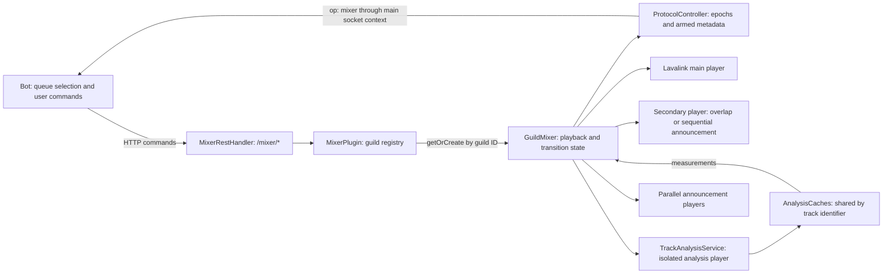
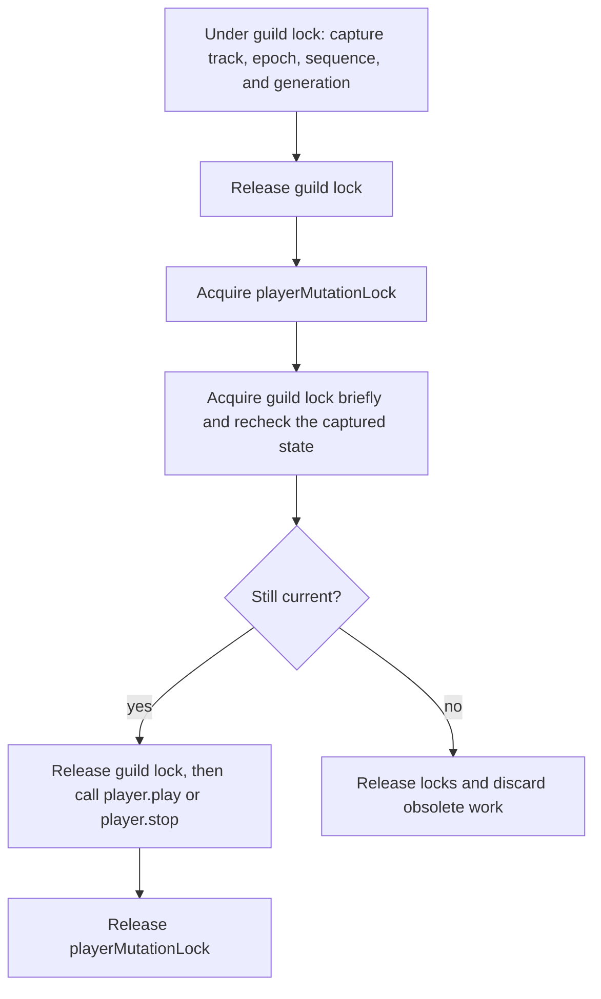
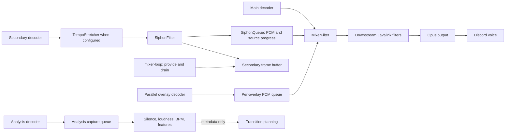
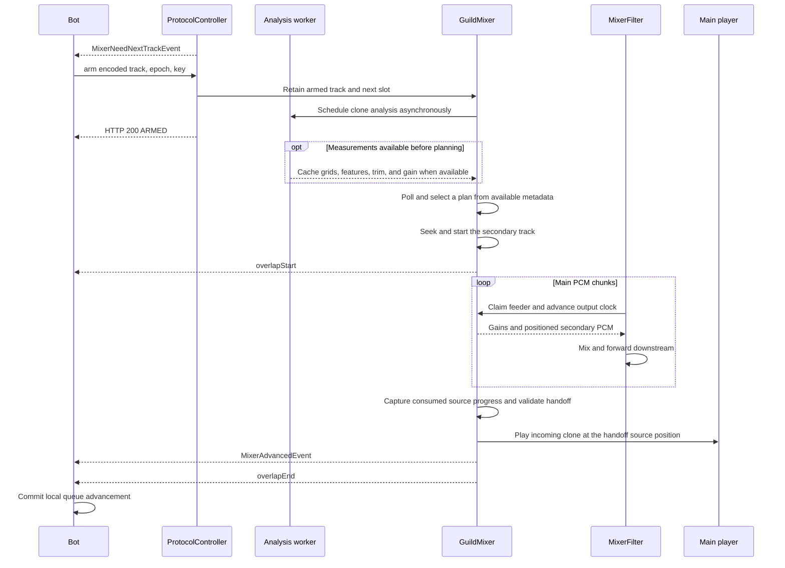
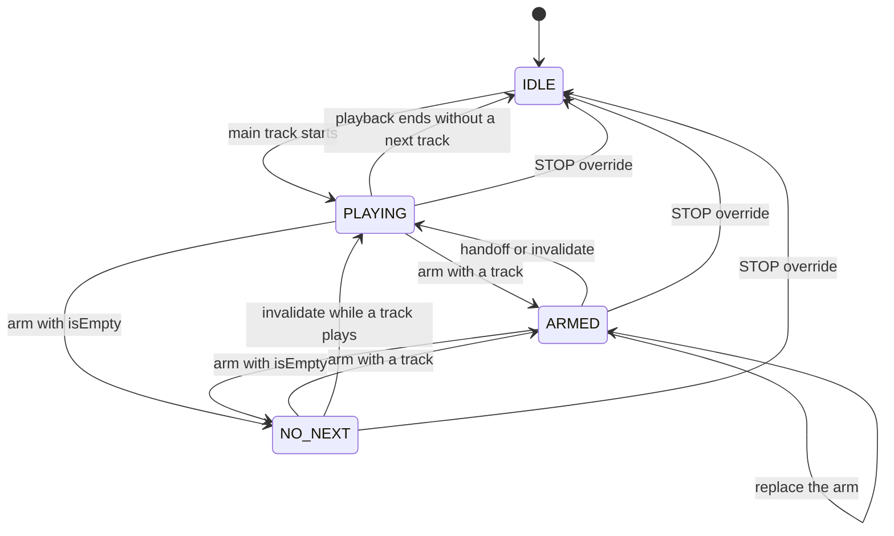

# Architecture reference

This reference describes the running implementation. For a walkthrough in Korean,
see the [BPM extraction explanation](bpm-extraction.ko.md) and the
[bot integration guide](../examples/lavalink-client/README.ko.md).

## Runtime boundary

`lavalink_mixer` is a plugin loaded by a Lavalink server. There is no standalone
application entry point. Spring discovers the services in
`io.github.mochilabs.mixer` through the plugin descriptor at
`src/main/resources/lavalink-plugins/mixer-plugin.properties`.

The build uses Kotlin 2.1.20 and targets JVM 17. Its host dependencies are
Lavalink plugin API 4.2.2, Lavaplayer 2.2.6, and lavadsp 0.7.8.
These versions describe this repository's build, not the latest upstream releases.

## System boundary and ownership



The bot stores the full queue and chooses its next item. The plugin stores one
armed next track, not a copy of that queue. Initial playback uses Lavalink's
normal player API. Later server-driven advancement consumes the armed slot.
`MixerAdvancedEvent` tells the bot to update its local queue.

The main player belongs to Lavalink. `MixerEvents.onNewPlayer()` attaches it to
the guild mixer. The secondary and analysis players are created as needed and
do not own Discord voice connections. Each parallel announcement has its own
player. A crossfade handoff clones the incoming track into the existing main
player. It does not replace the Lavalink player with the secondary player.

The registry is process-wide, while player state and protocol state are per
guild. Analysis caches are shared across guilds. Destroying an obsolete player
from an old session does not remove a mixer attached to a newer player.

## Ownership and execution

| Component | Responsibility |
| --- | --- |
| `MixerPlugin` | Stores mixers by guild ID and resolves encoded tracks or source identifiers. |
| `MixerEvents` | Attaches new Lavalink players and removes a mixer when its attached main player is destroyed. |
| `GuildMixer` | Owns main-player binding, secondary playback, next-track slots, gains, transitions, and overlay slots. |
| `ProtocolController` | Owns protocol state, armed-track metadata, JIT requests, and the ordered action executor. |
| `EpochGate` | Tracks the current epoch, reset grace window, and recent request fingerprints. |
| `TrackAnalysisService` | Owns a separate analysis player and capture filter for each guild. |
| `AnalysisCaches` | Shares identifier-keyed measurements across guilds. |

`MixerPlugin` schedules `drain()` every 20 ms and `poll()` every fifth tick.
The same scheduler checks analysis retries and queued announcements.
A fixed analysis pool has `analysisThreads` workers, clamped to 1–8.
Each protocol controller has a single scheduled executor named `mixer-v2-action`
for ordered actions and delayed JIT notifications.

Audio filter callbacks and player event callbacks also access mixer state.
The system is not confined to the protocol executor. `GuildMixer.lock` guards
compound state transitions, with volatile fields and atomics for selected values.
The outer `playerMutationLock` serializes main-player mutations across handoff,
gapless advance, and override. Acquiring it while holding `lock` violates the
documented lock order.

Player operations that can trigger callbacks occur outside the state lock in
the transition paths. Epoch, sequence, generation, and track-identity checks
reject work superseded while that lock was released.

### Execution contexts

| Context | Work performed | Coordination |
| --- | --- | --- |
| REST request thread | Parse requests, check epochs, accept arms and settings | Guild state lock around compound changes |
| `mixer-v2-action` | Ordered overrides, callback recovery, overlap preparation, and delayed JIT dispatch | Player-mutation lock and state rechecks for main-player changes |
| `mixer-loop` | Drain secondary frames every 20 ms, poll every fifth tick, retry analysis, start announcements | Plans state changes before callback-producing operations |
| `mixer-analysis` pool | Decode clones, measure silence and loudness, extract BPM and features | One active analysis per guild, shared worker limit across guilds |
| Lavaplayer callbacks | Track start, end, stuck, and failure handling | Identity and generation checks reject obsolete work |
| PCM filter callback | Advance the elected feeder's sample clock, apply gains, consume queues, mix, forward PCM | Atomics, gain snapshots, and bounded queue operations |

The shared scheduler is not a worker per guild. A slow operation on that scheduler
can delay other guilds, which is why analysis decoding runs on the separate pool.
`analysisThreads` limits concurrently running workers. It does not guarantee that
every submitted analysis starts immediately.

### Player-mutation lock order



This diagram describes the main-player mutation paths, not every method in the
class. Never acquire `playerMutationLock` while holding `GuildMixer.lock`.
The reverse order is allowed for a short recheck. `play()` and `stop()` can
synchronously trigger player callbacks, so invoking them under the state lock
would make callbacks part of the locked transition.

An epoch rejects older client work. `advanceSeq` distinguishes playback advances.
Slot revisions and sub-player generations distinguish replacements within those
operations. Track-object identity prevents a transition planned for one main
track from handing off after another track has replaced it. These checks have
different scopes and are not interchangeable.

## Audio flow



Solid arrows carry audio or analysis data. Dashed arrows describe pumping or
metadata. Analysis PCM does not feed the live secondary queue. Draining a
secondary player's output advances its decoder even though its own encoded
frames are not sent to Discord.

The main decoder sends PCM through `MixerFilter` and then downstream toward
Lavalink's output. The secondary decoder sends PCM through an optional
`TempoStretcher` and `SiphonFilter`. The siphon copies PCM into `SiphonQueue`
while also forwarding audio to its own downstream frame buffer. The scheduler
drains secondary output so decoding continues.

`MixerFilter` consumes captured secondary PCM, applies the main and secondary
gains, adds parallel overlays, and forwards the result. The mixing path uses
a soft limiter above an absolute amplitude of 0.9. Main-only attenuation has
a separate path. Idle audio passes through unchanged.

The filter is enabled per guild with `pluginFilters.mixer.guildId`. The ID is
a JSON string. The extension receives no player identity, so the ID binds
the filter to the guild registry. The filter looks up that registry on every
chunk, allowing a newly created or replacement mixer to receive audio.

Two filter chains can briefly refer to one guild during reconnects. Feeder
election lets only one chain consume the shared PCM and advance audio state.
Closing a filter retires its feeder ID.

`SiphonQueue` is bounded by samples per channel, rather than decoder chunks.
Overflow removes old queued audio, and underflow fills the missing portion
with zeroes. Its production capacity accounts for Lavaplayer frame-buffer prefill.
Each queued frame records the source-rate span attributed to its output. Native
output can be delayed, so the stretcher maintains a FIFO of submitted rate spans
rather than reading the most recently requested rate. Reads and discards use that
speed, so a later native failure does not reinterpret already queued audio
at the fallback speed.

At crossfade handoff, the incoming track is cloned into the main player.
Its seek position comes from consumed source samples plus its starting position.
Tempo-adjusted source progress differs from output sample count. Both differ
from decoder progress, which includes buffered audio not yet heard.
Secondary reads use output coordinates to account for bounded queue overflow.
Discarded source progress contributes to the handoff seek, but not to the audible
secondary sample counter. Underflow zero-fills without inventing source progress.

Player end, stuck, and exception callbacks run while Lavaplayer holds its
`trackSwitchLock`. They enqueue recovery on the guild's protocol action executor.
Recovery acquires `playerMutationLock` there and rechecks player identity, epoch,
sequence, queue identity, and slot revision before acting. Listener registration
also runs outside the guild state lock. The PCM filter reads a published parallel
overlay snapshot and volatile sequential-overlay state without acquiring that lock.

Overlap preparation also uses the action executor. Poll schedules it up to two
seconds before the planned fade, and the worker waits up to two seconds for one
second of secondary PCM or a fully decoded shorter track. A separate clone feeds
the secondary player; the original queue slot remains available until commit.
Epoch, sequence, track, and slot checks cancel stale preparations. A late ready
source rebases the fade start to the current main sample coordinate, keeping the
planned handoff and shortening the remaining fade. This prevents `takeAt` from
discarding newly arrived PCM to chase a window that started before decoding.
The crossfade secondary pump pauses while at least one second of PCM is banked, so
early preparation does not drain into queue overflow before the fade. Chunks
crossing the fade start zero-fill their prefix without consuming incoming PCM.

At overlap planning, console diagnostics snapshot the cached outgoing tail and
incoming head measurements and configured matching limits. Once preparation
commits, one INFO line reports those inputs and the applied beat-match decision.
Progress, buffer starvation, late-start details, and handoff logs use DEBUG.
Failure and abort warnings remain enabled. Diagnostic formatting does not decode
audio or run another analysis pass.

### The three playback positions

| Position | Meaning | Used for |
| --- | --- | --- |
| Secondary decoder position | How far the decoder has produced, including buffered output | Diagnostics |
| Secondary output samples | Audio samples supplied on the output timeline | Audible output and overlap timing |
| Secondary source progress | Source samples represented by consumed or deliberately skipped queued output, adjusted for speed | Seek position at handoff |

For a source speed `r`, one output sample represents approximately `r` source
samples. The queue integrates that progress across rate spans:

```text
sourceSamples = sum(outputSamplesInSpan * sourceSpeedInSpan)
handoffMs = incomingStartMs + sourceSamples * 1000 / 48000
```

For example, four seconds of output at `1.02` speed represent 4080 ms of source
audio. A one-second linear recovery from `1.02` to `1.0` represents approximately
1010 ms more. The handoff is then about `incomingStartMs + 5090`, not the decoder's
possibly later position. This is an accounting example, not a measurement of
native stretcher latency or sample-exact WSOLA input positions.

The queue records progress in thousandths of a source sample to reduce repeated
rounding. Overflow advances its output/source cursor when dropping old data.
A read that needs to catch up advances the same cursor. Zero-filled underflow
does not invent source progress. Native processing can emit output after a
delay, so `TempoStretcher` attributes output to submitted rate spans in FIFO order.

### Crossfade lifecycle



This is the overlap path. Analysis can finish after planning, or return no usable
grid. Playback does not wait indefinitely for a beat result. A gapless path
consumes the ready or pending track directly and emits `MixerAdvancedEvent`
without requiring an `overlapStart` event. The relative arrival of the HTTP arm
response and background analysis is not a readiness guarantee.

## Protocol v2

`MixerRestHandler` exposes `/mixer/*`. The full request and response reference
is [api/openapi.yaml](../api/openapi.yaml). `MixerEvents.kt` contains the helper
that sends custom WebSocket messages with `op: "mixer"` to the main player's session.

| State | Implementation meaning |
| --- | --- |
| `IDLE` | Protocol state has no active playback. |
| `PLAYING` | Playback can request a next track through the JIT window. |
| `ARMED` | An incoming track has been accepted; analysis may still be pending. |
| `NO_NEXT` | The client has declared that no next track is available. |

The protocol's armed slot and the mixer's pending/ready analysis slots are
distinct. `arm()` sets `ARMED` before scheduling analysis. It does not imply
that analysis is complete.



This chart shows common control paths. Reset selects `PLAYING` or `IDLE` from
the attached main player. `PLAY_NOW` selects `PLAYING` and schedules a main-player
mutation. State changes, player mutation, PCM consumption, and event delivery
are separate steps. `ARMED` is not an additional audio player or an analysis state.

`checkJitWindow()` requests the next track when the known duration has at most
`crossfadeMs + 7000` ms remaining, or `crossfadeMs + min(2 * bpmScanMs + 7000, 120000)`
ms when BPM detection and beat matching are enabled. This reserves time for
head and tail scans. Short tracks receive a 500 ms settle delay.
The reset grace window can delay dispatch further. Sequence checks suppress
duplicate notifications and notifications for replaced tracks.

The bot answers with `/mixer/queue/arm`, invalidates a changed queue with
`/mixer/queue/invalidate`, and uses `/mixer/queue/override` for `STOP` or
`PLAY_NOW`. These operations and `/mixer/reset` require an `Idempotency-Key`.
Configuration endpoints do not require that header.

An arm can include `startPositionMs` for the incoming track. The protocol
controller validates it before recording the idempotency key and retains it
with the armed slot. Crossfade seeks the secondary decoder before prefill;
gapless seeks the next main track before play, including for a preserved
transition. Beat alignment cannot choose an earlier position. The handoff
position still comes from consumed secondary source samples plus that actual
start position. `/mixer/info` advertises support so clients can check each node.

An arm can also include `outgoingEndPositionMs` to mark the start of an
outgoing SponsorBlock outro as the effective content end. The overlap plan
starts the fade before that position and hands off there. Without an overlap,
the mixer advances the armed track at that position. The cutoff is tied to the
current track instance and cleared with the armed slot; an already passed
cutoff is ignored. `/mixer/info` advertises this capability separately.

`EpochGate` retains up to 64 recent request fingerprints per guild. It checks
existing keys before checking the reset window and epoch. A matching fingerprint
is a duplicate; a different fingerprint is a payload mismatch. A new request
with an epoch below `lastKnownEpoch` is stale. Equal epochs are accepted.
Fingerprints are operation-specific strings, not hashes of the full JSON body.

Reset keeps the maximum of the previous and supplied epochs, clears prior
request keys, records its own key, and opens an optional grace window.
The default grace is 1500 ms. Idempotency is bounded, in-memory behavior,
not a durable exactly-once guarantee across restarts or cache eviction.

`MixerAdvancedEvent` reports server-driven advancement. The client must sync
its queue without independently starting the same next track. The bot wiring
guide requires `autoSkip: false`. Crossfade advances include a `handoffId`.

## Analysis and overlays

Silence detection, normalization, BPM detection, and key detection default to disabled.
Analysis decodes through `TrackAnalysisService`, separate from live secondary
playback. `AnalysisState` serializes scans per guild and limits repeated failures.
Pending tracks can advance without completed analysis when content ends.
BPM-only work can retry while the next track is already ready for playback.
A tail scan validates coverage against trimmed content end, including explicit tail
reanalysis. Comparing a trimmed scan with full file duration would discard valid
results as incomplete and prevent cache publication and next-track promotion.
A successful scan with no beat grid completes that scan rather than triggering
repeated decodes. The per-guild analysis state remembers the last such completion.

`AnalysisCaches` stores trim points, loudness, BPM, head/tail beat grids, and key estimates.
Each cache has a coarse size bound of 1000 and uses the track identifier as its
key. The key does not include guild settings. Concurrent callers can repeat
analysis; the cache does not guarantee one decode per identifier.

`NormalizationGain` measures K-weighted loudness and calculates linear gain.
Measurement filtering does not replace output PCM. Normalization defaults to
attenuation only. Silence detection combines offline trim points with a realtime
tail detector on raw main PCM before gain application.

`TransitionFeatureAnalyzer` extracts bounded energy, rhythm stability, local chroma
key candidates and boundary candidates from the existing BPM PCM scans.
`KeyDetector` owns the shared chroma/profile estimator. Independent key analysis
uses a bounded head scan, reusing BPM PCM when its coverage is sufficient. Its
cache includes inconclusive results, so silence and ambiguous keys complete a
scan. REST snapshots include track identity and window coverage. These are local
major/minor estimates with heuristic confidence, not calibrated whole-song labels.
`AdaptiveTransitionPlanner` is the single planner for transitions. It consumes
`ExtendedBeatGrid` (with downbeat and merged phrase confidence) and `TransitionFeatures`,
generating a declarative `TransitionRecipe` and deriving the phase-snapped `CrossfadePlan`
from that recipe. `CrossfadePlan.overlapMs` controls gain fading; `recoveryMs` reserves
an incoming-only speed recovery inside the total window. `TempoEnvelope` runs on projected
output sample coordinates in the secondary producer, so decoding ahead does not shift
its schedule. Keeping the native delegate alive at unity avoids discarding its tail.
Exact native per-output input positions are unavailable: FIFO source integration
is tested to a tolerance, not claimed sample-exact WSOLA correspondence. The wire
labels (`beat_matched`, `short_crossfade`, `crossfade`, `preserve`) remain for
protocol-v2 compatibility while the one-line `crossfade` log reports the active
`strategy=` and metric confidences.

### Adaptive Automix Engine

`AdaptiveTransitionPlanner` selects and generates declarative `TransitionRecipe` specifications
across an uncertainty-margin multi-level decision waterfall:
- **Level 0 (Grid-Based):** When `ExtendedBeatGrid` confidence is sufficient (`bpmConfidence >= minConfidence`).
  - **Sync Domain ($\Delta_{\log} \le \text{margin}$):** Executes `PHRASE_MATCHED_BASS_SWAP` (16-beat fade, cut at bar 4) when both downbeats and phrases are confident (`downbeatConfidence >= 0.5`, `phraseConfidence >= 0.5`), degrading to `SHORT_BASS_SWAP` (8-beat) or `BEATMATCHED_BLEND` (2/4/8-beat, phase-snapped) when metric boundaries are uncertain or for non-4/4 meters.
  - **Async Domain ($\Delta_{\log} > \text{margin}$):** Executes `DOWNBEAT_CUT` when both downbeats are confident and energetic, or `ECHO_OUT` (1/2-beat if BPM $\ge$ 125, 1-beat if BPM < 125) using a 96,000-sample circular delay buffer with an explicit linear termination ramp.
- **Level 1 (Degraded):** When beat grids are absent but envelope features are valid, executes a time-based high-pass `DEGRADED_FILTER_SWEEP` ($20\text{Hz} \to 3000\text{Hz}$).
- **Level 2 (Absolute Fallback):** When all metadata is missing or on buffer underrun, safely converges to a 5-second `ABSOLUTE_FALLBACK` Equal-Power crossfade.

In `MixerFilter`, real-time DSP automation runs with zero heap allocations during playback:
- **Dual LR4 Crossover (`CrossoverLR4`):** Both outgoing and incoming stereo audio streams pass through matched 4th-order Linkwitz-Riley filters (16 biquads total) at 200Hz. This guarantees identical group delay across both tracks, eliminating comb filtering while allowing low-frequency bass swap with 15ms smoothing ramps.
- **High-Pass Filter Sweep (`PcmBiquadFilter`):** Executes `FilterCutoff` sweeps in place on the outgoing stream during degraded transitions.
- **Circular Delay Buffer (`CircularDelayBuffer`):** Pre-allocated 96,000-sample stereo buffer (2.0s @ 48kHz, accommodating BPM 40) continuously banks incoming main audio and provides feedback delay with decay and linear fade-out termination on Echo Out triggers.
- **Transition Memory (`TransitionMemory`):** Tracks the recent history of applied transition strategies per guild and applies multiplicative penalties to shift between viable candidates and prevent consecutive mechanical repetition.

`requestPreanalysis` retains the latest warmup while another scan is queued or
active, and writes enabled silence, BPM, feature, and key caches. It never arms, promotes or changes
live gain. Current-track BPM and key analysis can run without a queued next track. Results are track-keyed; normal JIT
arming and epoch checks remain the authority for playback. Explicit preservation
is an optional arm field included in the idempotency fingerprint, never a global
sticky album mode.
`TempoStretcher` applies producer-side speed changes using lavadsp. Low confidence,
incompatible tempos, and unavailable grids can fall back to ordinary crossfade.
Native stretching failures fall back to forwarding unstretched PCM.
Beat phase is not a musical downbeat. Enabling beat matching does not by itself
enable BPM analysis in `updateBeatmatch()`.

`BpmDetector` normalizes energy and spectral analysis levels, retains local
autocorrelation tempo candidates, and fits each candidate's period/phase with WLS.
Tempo selection combines duration-aware accent periodicity, coverage of those
accents by the fitted grid, and a log-tempo prior. Onset timing weights remain
separate from metrical salience. Nearby integer BPM values are accepted only when the same assigned onsets support their residual.
The first energy onset remains distinct from fitted grid phase. Confidence is
periodicity, not metrical-level certainty. The detector remains pure Kotlin/JVM;
its [research and calibration notes](bpm-detector-design.md) describe policy values
and the strong-hi-hat octave regression checks. The default scan stays at 30 seconds.

Sequential announcements share the secondary player with crossfades.
`AnnouncementQueue` defers track resolution until playback and can requeue
an item if the secondary player becomes busy. Parallel announcements own
separate players, queues, and gain ramps. Their count defaults to four and
is clamped to 1–16 per guild.

## Version and design references

- `/mixer/info` returns the version resolved from the packaged plugin
  descriptor, which Gradle fills from the build version; the value matches the
  running JAR.
- The beat-matching plan describes work that is already implemented. Current
  source and tests establish what is present.
