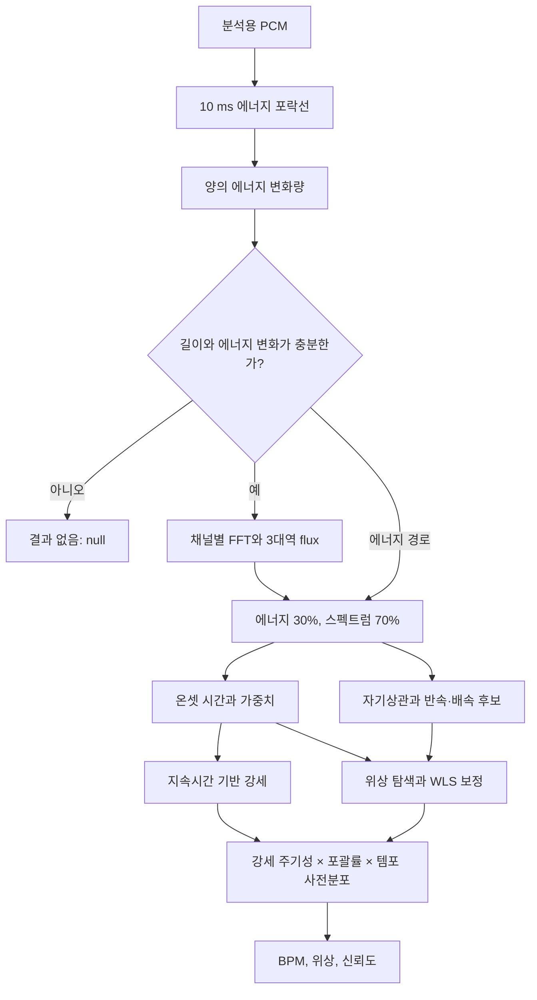
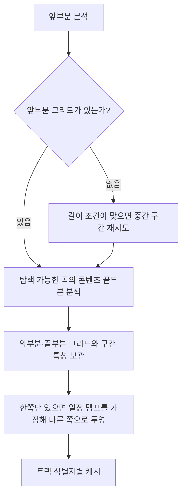

# BPM 추출 알고리즘 해설

이 문서는 PCM에서 BPM과 비트 위치를 어떻게 얻고, 그 결과를 곡 전환에 어떻게 사용하는지 설명합니다. 현재 Kotlin 구현을 기준으로 입력부터 출력까지 따라갑니다. 논문 비교와 과거 측정 기록은 [BPM 검출기 설계 근거](bpm-detector-design.md), 실제 WAV 평가 방법은 [캘리브레이션 가이드](bpm-calibration.md)에 있습니다.

핵심 구현은 [BpmDetector.kt](../src/main/kotlin/io/github/mochilabs/mixer/analysis/BpmDetector.kt), [SpectralFlux.kt](../src/main/kotlin/io/github/mochilabs/mixer/analysis/SpectralFlux.kt), [TrackAnalysisService.kt](../src/main/kotlin/io/github/mochilabs/mixer/analysis/TrackAnalysisService.kt)입니다. 실행 중인 음악을 분석용 플레이어에 넘기는 것이 아니라 트랙 복제본을 별도로 디코딩합니다.

필요한 깊이에 따라 다음 구간부터 읽을 수 있습니다.

- [PCM과 에너지 전처리](#3-pcm을-약-10-ms-단위의-에너지로-바꾸기)
- [FFT와 spectral flux](#5-주파수별-공격음을-spectral-flux로-검출하기)
- [템포 후보와 정밀 적합](#8-자기상관으로-여러-템포-후보-유지하기)
- [비트 매칭에 적용](#13-추출-결과를-비트-매칭에-사용하기)
- [결과의 한계](#14-결과를-해석할-때의-한계)

## 1. BPM 하나만으로 두 곡을 맞출 수 없는 이유

120 BPM은 한 박자가 500 ms라는 뜻입니다. 다음 두 곡은 BPM이 같아도 비트가 어긋납니다.

```text
곡 A의 비트:   0, 500, 1000, 1500 ms
곡 B의 비트: 250, 750, 1250, 1750 ms
```

따라서 검출기는 속도뿐 아니라 반복되는 비트가 어디에 놓이는지도 추정합니다.

| 값 | 의미 | 주의할 점 |
| --- | --- | --- |
| `bpm` | 분석 구간에서 추정한 분당 박자 수 | 실제 음악의 반속·배속 중 잘못된 계층을 선택할 수 있음 |
| `periodMs` | `60000 / bpm`으로 계산한 박자 간격 | 일정한 간격의 지역 그리드이며 곡 전체의 템포 변화를 표현하지 않음 |
| `phaseMs` | 트랙 좌표에서 비트 그리드의 기준점 | 마디의 첫 박자나 첫 소리의 시작점과 다름 |
| `confidence` | 선택한 주기 부근에서 온셋 신호가 반복되는 정도 | BPM이 음악적으로 맞을 확률이 아님 |
| `firstBeatMs` | 에너지 기반으로 처음 감지한 온셋의 위치 | 기존 `BpmResult`의 값이며 그리드 위상으로 해석하면 안 됨 |

`BpmDetector.analyze()`는 기존 스칼라 결과인 `BpmResult`를 반환합니다. `analyzeGrid()`는 [BeatGrid](../src/main/kotlin/io/github/mochilabs/mixer/analysis/BeatGrid.kt)를 반환합니다. `BpmResult.phaseMs`는 호환용으로 `firstBeatMs`를 가리키지만, `BeatGrid.phaseMs`는 전체 온셋으로 맞춘 그리드 위상입니다.

## 2. 전체 처리 흐름



스펙트럼 분석이 불가능하거나 실패하면 에너지 flux만 사용합니다. 다만 에너지 변화량의 초기 게이트는 스펙트럼 분석보다 먼저 적용됩니다. 강한 스펙트럼 변화가 있어도 그 초기 조건을 통과하지 못하면 결과는 없습니다.

## 3. PCM을 약 10 ms 단위의 에너지로 바꾸기

입력은 `List<Array<FloatArray>>`입니다. 바깥 리스트는 디코더 청크, 배열은 채널, 각 `FloatArray`는 해당 채널의 PCM 샘플입니다. 청크 경계가 분석 hop 경계와 같을 필요는 없습니다.

기본 분석 출력은 48 kHz이며, hop은 `sampleRate / 100` 샘플입니다. 48 kHz에서는 480샘플, 44.1 kHz에서는 441샘플이므로 두 경우 모두 10 ms입니다. 검출 함수에는 실제 분석 PCM의 샘플레이트를 전달합니다. 원본 파일이 44.1 kHz여도 Lavaplayer 분석 출력이 48 kHz라면 48 kHz를 사용합니다.

hop `i`의 에너지는 채널별 샘플을 제곱한 뒤 평균한 값입니다.

$$
E_i = \frac{1}{H C}\sum_{n=0}^{H-1}\sum_{c=1}^{C}x_c[iH+n]^2
$$

여기서 `H`는 hop 샘플 수, `C`는 채널 수입니다. 마지막 불완전 hop은 실제 샘플 수로 나눕니다.

좌우 PCM을 더해 모노로 만든 뒤 제곱하면 역위상 스테레오가 상쇄될 수 있습니다. 이 구현은 채널별 에너지를 먼저 구하므로 `L = -R`인 경우에도 에너지가 사라지지 않습니다.

포락선이 8 hop보다 짧거나 평균 에너지가 `1e-9`보다 작으면 중단합니다. 이후 템포 탐색에서도 후보 주기의 두 배가 들어갈 길이가 필요합니다. 8 hop을 넘겼다는 이유만으로 BPM을 추정할 수 있는 것은 아닙니다.

## 4. 곡 볼륨에 덜 민감한 에너지 변화량 만들기

분석 구간의 평균 에너지로 각 hop을 나눕니다.

$$
\widetilde E_i = E_i / \overline E
$$

전체 PCM 진폭이 두 배가 되면 에너지는 네 배가 되지만 평균 에너지도 네 배가 됩니다. 나눈 값은 같으므로 온셋 검출이 원래 볼륨에 덜 좌우됩니다. 이 계산은 분석용이며 출력 음악의 볼륨을 바꾸지 않습니다.

박자 공격음은 에너지가 늘어날 때 나타나므로 증가분만 남깁니다.

$$
F^E_i = \max(0, \widetilde E_i - \widetilde E_{i-1})
$$

그다음 앞뒤 50 hop의 지역 평균을 빼 완만한 추세를 제거합니다. 추세를 제거한 에너지 flux의 평균제곱이 `0.02`보다 작으면 주기 분석을 중단합니다. `0.02`는 현재 정책값이며 실제 음악 전체에 보장되는 임계값이 아닙니다.

## 5. 주파수별 공격음을 spectral flux로 검출하기

에너지 변화만으로는 킥, 스네어, 하이햇을 구분하기 어렵습니다. 스펙트럼 경로는 어떤 주파수의 크기가 증가했는지를 봅니다.

각 채널을 따로 Hann 윈도로 감싼 뒤 2048포인트 [RealFft](../src/main/kotlin/io/github/mochilabs/mixer/analysis/RealFft.kt)를 계산합니다. 48 kHz에서 윈도 길이는 약 42.7 ms이며 약 10 ms씩 이동합니다. 따라서 FFT 윈도와 hop 길이는 서로 다릅니다. 구간 밖 샘플은 0으로 채우고, 프레임은 hop 중심에 맞춰 배치합니다.

FFT 크기를 로그 압축하기 전에 분석 구간 RMS를 기준값 `0.1`에 맞추는 공통 배율을 적용합니다. 각 FFT 프레임의 RMS를 따로 같게 만드는 방식이 아닙니다.

$$
L_i(k) = \frac{1}{C}\sum_c \ln\left(1 + 10 |X_{i,c}(k)|\frac{1024}{2048}\frac{0.1}{\sqrt{\overline E}}\right)
$$

공통 배율을 로그보다 먼저 적용하는 이유는 `log(1+x)`가 비선형이기 때문입니다. 로그 압축을 먼저 하면 나중에 포락선을 정규화해도 조용한 곡과 큰 곡의 온셋 모양이 달라질 수 있습니다.

이후 양의 스펙트럼 변화량을 대역별로 합칩니다.

$$
F^b_i = \sum_{k\in b}\max(0, L_i(k)-L_{i-1}(k))
$$

| 대역 | 명목 주파수 | 48 kHz에서 사용하는 bin | 기본 가중치 |
| --- | --- | --- | --- |
| 저역 | 30–150 Hz | 1–6 | 0.40 |
| 중역 | 150–2000 Hz | 7–85 | 0.40 |
| 고역 | 2000–10000 Hz | 86–427 | 0.20 |

각 대역을 해당 flux의 표준편차로 나눈 뒤 가중합합니다. 저역의 절대 크기가 크다는 이유로 다른 공격음이 묻히는 것을 줄입니다. 표준편차가 `0.05` 미만인 비활성 대역은 가중치를 0으로 만듭니다. 모든 대역이 비활성이면 spectral flux는 `null`이 됩니다.

## 6. 두 flux를 결합하고 온셋을 추출하기

스펙트럼 결과가 있으면 에너지 flux와 spectral flux를 각각 표준편차로 나누고 다음처럼 합칩니다.

$$
F_i = 0.30\frac{F^E_i}{\sigma_E} + 0.70\frac{F^S_i}{\sigma_S}
$$

표준편차가 충분하지 않은 항의 배율은 0으로 둡니다. 스펙트럼 결과가 없으면 에너지 flux를 그대로 사용합니다.

온셋 임계값은 대략 5초 구간의 평균과 표준편차를 따라 움직입니다.

$$
\theta_i = \max\left(\mu_{local}+1.5\sigma_{local},\ \mu_{global}+0.5\sigma_{global},\ 0.05\right)
$$

연속해서 `F_i > theta_i`인 영역을 하나의 온셋으로 합칩니다. 매 hop의 임계값 초과 비율을 가중치로 사용합니다.

$$
w_i=(F_i-\theta_i)/\theta_i,\qquad t_{onset}=\frac{\sum_i i w_i}{\sum_i w_i}
$$

최대값이 있는 hop 하나를 고르는 대신 영역의 가중 중심을 사용하므로 hop 사이의 시각도 표현할 수 있습니다. 온셋의 시간 적합 가중치 `weight`는 이 영역의 `w_i` 합입니다.

스펙트럼 경로에는 `1.15 hop`, 즉 기본 해상도에서 11.5 ms의 온셋 위치 보정을 더합니다. 이는 현재 FFT·윈도·온셋 구성에 대한 합성 신호 보정값입니다. 다른 FFT 설정에도 그대로 맞는 상수로 해석하면 안 됩니다.

`firstBeatMs`는 별도의 에너지 임계값을 처음 넘긴 hop에서 구합니다. 이 값에는 스펙트럼 위치 보정을 적용하지 않습니다.

## 7. 왜 큰 하이햇을 박자 자체로 오인하는가

70 BPM의 곡에서 하이햇이 박자 사이마다 들어오면 공격음은 140회씩 반복될 수 있습니다. 가장 큰 피크나 자기상관 최대값만 고르면 140 BPM을 선택하기 쉽습니다. 반대로 모든 결과를 절반으로 나누면 원래 빠른 곡도 틀립니다.

이 구현은 온셋의 날카로움과 음악적 강세를 다른 가중치로 취급합니다.

- `weight`는 공격음의 시각을 맞추는 데 사용합니다.
- `salience`는 어떤 반복 간격을 박자로 선택할지 비교하는 데 사용합니다.

온셋 주변 PCM에서 짧은 RMS 포락선을 구합니다. 창은 온셋보다 두 hop 앞에서 시작하고, 다음 온셋 창의 시작이나 가장 짧은 후보 주기에서 끝납니다. RMS 블록은 hop의 약 4분의 1 길이입니다.

RMS 포락선의 면적을 최고 RMS로 나누면 같은 높이의 직사각형으로 환산한 지속시간을 얻습니다. 여기에 포화된 온셋 가중치를 곱합니다.

$$
D = \frac{\operatorname{area}(RMS)}{\operatorname{peak}(RMS)\,H},\qquad s = D\frac{w}{1+w}
$$

짧고 날카로운 공격음은 `w`만 무한히 커져도 지속시간 이상의 영향력을 얻지 못합니다. 전체 볼륨이 바뀌어도 면적과 최고 RMS가 함께 바뀌므로 `D`는 유지됩니다. 긴 잔향이 언제나 음악적 박자를 뜻하는 것은 아니므로 이것도 휴리스틱입니다.

각 온셋의 `salience`를 폭 1 hop의 Gaussian으로 배치해 강세 신호를 만듭니다. 이 신호의 자기상관과 그리드 포괄률이 후보 선택에 사용됩니다.

## 8. 자기상관으로 여러 템포 후보 유지하기

자기상관은 신호를 일정 시간 밀었을 때 원래 신호와 얼마나 비슷한지 계산합니다. 약 500 ms 이동에서 잘 맞으면 120 BPM 후보가 생깁니다.

기본 탐색 범위는 60–200 BPM입니다. 10 ms hop에서는 약 30–100 hop의 지연을 살펴보며, 최대 지연은 분석 길이의 절반으로도 제한합니다.

지역 평균을 제거한 신호를 `x`, 전체 길이를 `n`, 지연을 `l`이라고 하면 사용되는 정규화는 다음과 같습니다.

$$
R(l)=\operatorname{clamp}_{[0,1]}\left(\frac{\sum_{i=0}^{n-l-1}x_i x_{i+l}/(n-l)}{\sum_i x_i^2/n}\right)
$$

최댓값 하나만 남기지 않습니다. 전체 flux의 지역 최대값, 에너지 flux의 가장 강한 후보, 반속·배속에 해당하는 지연 후보를 함께 보존합니다. 탐색 범위를 벗어난 후보는 제거합니다. 한 hop 이내의 이웃 후보는 실제 자기상관 값으로 비교해 합칩니다.

후보마다 주기와 위상을 먼저 맞춘 뒤 최종 점수를 비교합니다. 반속·배속 문제를 특정 BPM 구간에 대한 예외 처리로 해결하지 않습니다.

## 9. 주기와 위상을 정밀하게 맞추기

정수 hop만으로 템포를 표시하면 간격이 거칩니다. 예를 들어 120 BPM은 50 hop이지만 121 BPM은 약 49.587 hop입니다. 검출기는 다음 단계를 거쳐 소수 hop 주기를 구합니다.

1. 자기상관 피크와 양옆 값을 포물선으로 보간합니다. 꼭짓점이 ±0.5 hop 범위를 벗어나거나 오목하지 않으면 정수 지연을 유지합니다.
2. 후보 주기에 가까운 온셋 간격을 모아 가중 중앙값으로 초기 주기를 보완합니다. 간격이 충분하지 않거나 상관 기반 주기와 5%보다 크게 다르면 상관 결과를 유지합니다.
3. 한 주기 안에서 위상을 0.1 hop 간격으로 탐색합니다. 기본 해상도에서는 1 ms 간격이지만 이것이 실제 오차 1 ms를 보장하지는 않습니다.
4. 온셋을 가장 가까운 비트 번호에 배정하고, 가중 최소제곱법으로 주기와 위상을 함께 보정합니다.

온셋과 가장 가까운 그리드의 거리를 `d`, 허용 거리를 `tol`이라고 할 때 위상 점수는 다음 커널을 사용합니다.

$$
K(d,tol)=\begin{cases}\cos^2(\pi d/(2tol)) & d<tol\\0 & d\ge tol\end{cases},\qquad tol=\max(1.5,0.10T)
$$

가중 최소제곱법은 `t_j ≈ phi + k_j T`를 맞춥니다. `k_j`는 비트 번호, `t_j`는 관측 온셋, `w_j`는 시간 적합 가중치입니다.

$$
T=\frac{\sum_j w_j(k_j-\bar k)(t_j-\bar t)}{\sum_j w_j(k_j-\bar k)^2},\qquad \phi=\bar t-T\bar k
$$

적합은 주기의 22%, 12%, 8% 순으로 허용 오차를 줄이며 반복합니다. 각 단계의 최소 허용 폭은 1.2 hop입니다. 관측치 4개와 서로 다른 비트 번호 3개 이상이 필요하며, 초기 주기에서 3%보다 큰 보정은 허용하지 않습니다. 조건을 충족하지 못하면 마지막으로 성공한 적합을 사용합니다. WLS가 한 번도 성공하지 못하면 초기 주기와 위상 탐색 결과를 유지합니다.

## 10. 정수 BPM으로 반올림하는 조건

127.999라는 수치 오차를 128로 정리할 수는 있지만, 실제 127.6 BPM까지 반올림하면 긴 구간에서 비트가 틀어집니다. 따라서 가까운 정수라는 이유만으로 값을 바꾸지 않습니다.

정수 보정에는 다음 조건이 모두 필요합니다.

- 자유 적합 BPM과 가장 가까운 정수의 차이가 0.15 BPM 이내.
- 적합에 배정된 온셋이 8개 이상.
- 배정된 비트 번호의 범위가 12 이상.
- 같은 온셋과 같은 비트 배정을 사용해 위상만 다시 맞췄을 때 아래 잔차 조건을 충족.

$$
RMS_{integer}\le1.2\,RMS_{free}+0.1\text{ hop}
$$

기본 hop에서 마지막 여유는 1 ms입니다. 온셋을 유리하게 다시 선택하지 않고 동일한 관측치를 비교하는 것이 핵심입니다. 이 규칙은 음원이 기계적으로 제작되었다는 판별이 아닙니다. 허용 잔차 안의 작은 실제 템포 차이도 정수로 정리될 수 있습니다.

## 11. 최종 후보 점수와 신뢰도는 다른 값

후보 선택 점수는 세 항의 곱입니다.

$$
score = R_{accent}(l)\times coverage(T,\phi)\times prior(BPM_l)
$$

`coverage`는 전체 강세 중 그리드 근처에 들어온 강세의 비율입니다. 앞의 코사인 커널로 거리를 반영합니다. 반속 후보가 킥만 맞추고 중간 스네어를 놓치면 포괄률이 낮아집니다.

사전분포는 중심 120 BPM, 폭 1옥타브의 로그 템포 분포입니다.

$$
prior(b)=\exp\left(-\frac12\left(\log_2(b/120)\right)^2\right)
$$

이 항은 원래 후보 지연으로 계산한 BPM에 적용합니다. 최종 출력 BPM은 해당 후보의 정밀 적합 주기로 계산합니다. 사전분포는 비슷한 후보를 비교하는 편향이며, 실제 음원의 템포를 미리 안다는 뜻이 아닙니다.

`coverage`는 구조적으로 빠른 쪽을 편듭니다. 주기가 절반인 격자는 느린 격자의 점을 모두 포함하기 때문입니다. 그래서 8분음표 하이햇이나 베이스가 있는 100 BPM 곡이 200 BPM 후보에 졌습니다. 선택된 후보가 155 BPM 이상이면 세분 판정을 한 번 더 합니다. 빠른 격자 주기의 두 배를 느린 격자로 보고, 그 반박 위치 온셋의 평균 attack prominence를 박 위치 온셋과 비교합니다. 위상 두 가지 중 비율이 작은 쪽을 씁니다.

$$
evidence = 15\,(0.48-\rho) + \log prior_{0.5}(BPM_{slow}) - \log prior_{0.5}(BPM_{fast})
$$

여기서 $\rho$는 반박/박 prominence 비율이고 $prior_{0.5}$는 중심 120 BPM, 폭 0.5옥타브의 로그 사전분포입니다. `evidence > 0`이고 느린 후보의 강세 주기성이 빠른 후보의 80% 이상이며 반박 위치 온셋이 25% 이상일 때 느린 후보를 고릅니다. 155 BPM 미만에서는 판정하지 않습니다. 같은 소리를 강약으로 번갈아 치는 125 BPM이 62.5로 떨어지지 않게 하기 위해서입니다. 스네어가 킥보다 훨씬 약한 빠른 백비트는 이 규칙에서 반속으로 읽힙니다. `BpmOctaveTest`가 이 한계를 기록합니다.

반환하는 `confidence`는 위 점수가 아닙니다. 선택 지연의 ±1 hop에서 구한 에너지 flux 자기상관과 결합 flux 자기상관 중 큰 값입니다. 온셋이 4개 미만이면 0으로 둡니다. `analyzeGrid()` 자체는 낮은 신뢰도라는 이유만으로 결과를 버리지 않습니다. 전환 정책이 기본 `0.30` 문턱을 적용합니다.

규칙적인 70 BPM과 140 BPM은 둘 다 높은 반복성을 가질 수 있습니다. 따라서 높은 `confidence`도 올바른 음악적 박자 계층이나 마디 위치를 보장하지 않습니다.

## 12. 앞부분·뒷부분 분석을 트랙 좌표로 연결하기

`TrackAnalysisService`는 기본적으로 앞부분과 끝부분을 각각 `bpmScanMs`만큼 분석합니다. 기본값은 30000 ms이며 REST 허용 범위는 5000–60000 ms입니다. 짧은 곡은 한 번 수집한 PCM에서 앞·뒤 결과를 함께 만들 수 있습니다.

끝부분 시작점은 `contentEndMs - bpmScanMs`입니다. 끝무음을 알고 있으면 `contentEndMs = duration - trailingSilenceMs`를 사용합니다. 탐색 오차를 보완하려고 끝부분 수집에는 2000 ms 여유를 둡니다. 분석 완료 여부도 파일 전체 끝이 아닌 잘라낸 콘텐츠 끝을 기준으로 확인합니다.



앞부분에 리듬이 없으면 곡 길이의 약 4분의 1 지점, 최대 60초를 후보로 다시 분석합니다. 실제 시작점은 스캔 길이·앞무음·남은 길이 조건으로 조정됩니다. 뒤에서 구한 주기를 앞부분으로 투영할 때는 그리드가 곡 내내 일정하다고 가정합니다. 앞·뒤 중 한쪽에서만 얻은 그리드를 다른 쪽에 보완하는 경로는 복사한 쪽 신뢰도에 `0.85`를 곱합니다.

`analyzeGrid(windowStartMs=150000)`은 지역 위상에 150000을 더해 트랙 좌표를 만듭니다. 예를 들어 지역 위상이 250 ms이고 BPM이 120이면 기준점은 150250 ms입니다. 그 앞뒤의 `150250 + k × 500`도 같은 그리드입니다. `phaseMs`가 항상 트랙 시작의 한 주기 안에 있다고 가정하면 안 됩니다.

캐시는 길드 설정이 아닌 트랙 식별자를 기준으로 공유됩니다. 설정을 바꿨다는 이유로 모든 결과가 자동으로 새로 분석된다고 가정하면 안 됩니다. 정상 분석이 끝났지만 그리드가 없는 결과도 완료로 취급해 같은 구간을 계속 디코딩하지 않습니다.

## 13. 추출 결과를 비트 매칭에 사용하기

[BPM 추출](../src/main/kotlin/io/github/mochilabs/mixer/analysis/BpmDetector.kt)과 [전환 정책](../src/main/kotlin/io/github/mochilabs/mixer/analysis/BeatMatchPolicy.kt)은 별개입니다. BPM이 있어도 에너지 차이, 리듬 안정성, 조성 충돌, 남은 길이 때문에 비트 매칭을 선택하지 않을 수 있습니다.

현재 곡이 120 BPM, 다음 곡이 118 BPM이면 다음 곡의 속도 배율은 다음과 같습니다.

$$
r=120/118\approx1.01695
$$

다음 곡을 약 1.7% 빠르게 재생하면 그리드 간격을 맞출 수 있습니다. 기본 `maxTempoChange=0.06`은 이 배율의 1.0과의 차이가 6% 이내여야 한다는 뜻입니다.

정책은 8박, 4박, 2박 순으로 페이드가 들어갈지 확인합니다. 120 BPM의 8박은 4000 ms입니다. 속도가 다르면 복구 시간도 전체 `crossfadeMs` 안에 확보합니다. 예를 들어 500 ms 복구가 필요하면 총 4500 ms가 필요합니다. 페이드가 끝난 뒤에는 다음 곡만 들리는 상태에서 원래 속도로 돌아갑니다.

`/mixer/state`의 `currentTrackBpm`은 원래 분석 템포이며, 일시적으로 늘이거나 줄인 재생 속도를 표시하는 값이 아닙니다. `currentTrackBpmIdentifier`를 현재 곡과 비교한 뒤 표시합니다. `nextTrackPhaseMs`도 박자 계층이나 음악적 마디를 확정하는 값은 아닙니다.

## 14. 결과를 해석할 때의 한계

이 구현은 학습된 모델이나 동적계획법 기반의 전곡 비트 추적기가 아닙니다. 분석 구간마다 일정한 주기와 위상을 맞추는 방식입니다.

- 라이브 연주의 템포 변화, 스윙, 루바토는 하나의 일정 그리드로 표현하기 어렵습니다.
- 인트로·아웃트로의 희박한 리듬과 긴 패드는 분석 실패나 다른 계층의 BPM을 만들 수 있습니다.
- 반속·배속 모호성은 줄일 수 있지만 모든 음악에서 해결된 것은 아닙니다.
- 합성 신호에서의 위상 오차 검사는 압축 음원 탐색, 네이티브 스트레처, 실제 Discord 재생의 오차를 함께 보장하지 않습니다.
- 현재 임계값과 적응형 전환 판단은 대표적인 실제 음악 데이터의 정확도 보증이 아닙니다.

BPM이 없거나 적합하지 않아도 다음 곡 재생을 막지 않습니다. 전환은 일반 크로스페이드나 겹침 없는 전환으로 진행할 수 있습니다.

## 15. 코드와 테스트를 연결해서 읽기

| 궁금한 내용 | 구현·검증 위치 |
| --- | --- |
| 무음·저변화 신호 게이트, 후보 선택, WLS, 정수 보정 | [BpmDetector.kt](../src/main/kotlin/io/github/mochilabs/mixer/analysis/BpmDetector.kt) |
| 채널별 FFT, 대역별 표준화, 로그 압축 | [SpectralFlux.kt](../src/main/kotlin/io/github/mochilabs/mixer/analysis/SpectralFlux.kt) |
| 앞·뒤 스캔, 재시도, 트랙 좌표, 끝무음 기준 | [TrackAnalysisService.kt](../src/main/kotlin/io/github/mochilabs/mixer/analysis/TrackAnalysisService.kt) |
| 볼륨·하이햇·반속·배속·정수 보정·위상 회귀 | [BpmPrecisionTest.kt](../src/test/kotlin/io/github/mochilabs/mixer/BpmPrecisionTest.kt) |
| 소수 주기, 구간 시작 좌표, 잘못된 첫 온셋 | [BpmGridTest.kt](../src/test/kotlin/io/github/mochilabs/mixer/BpmGridTest.kt) |
| 별도 디코더 분석과 캐시 통합 | [BpmIntegrationTest.kt](../src/test/kotlin/io/github/mochilabs/mixer/BpmIntegrationTest.kt) |

다음 명령은 기존 회귀 테스트를 실행합니다. 실제 음악 정확도는 별도의 정답 데이터와 [WAV 캘리브레이션](bpm-calibration.md)으로 평가해야 합니다.

```bash
./gradlew test --tests 'io.github.mochilabs.mixer.BpmDetectorTest' \
	--tests 'io.github.mochilabs.mixer.BpmPrecisionTest' \
	--tests 'io.github.mochilabs.mixer.BpmGridTest' \
	--tests 'io.github.mochilabs.mixer.BpmIntegrationTest'
```

DEBUG 로그의 `BPM relative energy-flux mean square`, `BPM candidate`, `BPM integer fit`를 함께 보면 어디서 결과가 바뀌었는지 추적할 수 있습니다. 로그의 후보 점수와 반환 `confidence`는 서로 다른 지표입니다.
