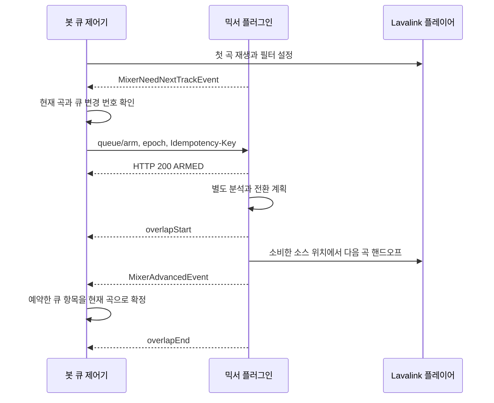

# 봇 연동 가이드: Mixer 프로토콜 v2

[English](README.md) | [한국어](README.ko.md)

이 가이드는 봇이 첫 곡을 시작한 뒤, 믹서가 다음 곡으로 전환하고 봇 큐가 그 결과를 따라가도록 연동하는 절차입니다. 일반 Lavalink v4 클라이언트와 별도의 `/mixer/*` HTTP 요청, 사용자 정의 WebSocket 이벤트 처리가 필요합니다. 특정 클라이언트의 메서드 이름에 의존하지 않는 요청 예제를 사용합니다.

정확한 필드·응답 스키마는 [OpenAPI](../../api/openapi.yaml), 내부 실행 구조는 [아키텍처](../../docs/architecture.md), 비트 분석은 [BPM 추출 해설](../../docs/bpm-extraction.ko.md)에 있습니다.

주요 구현 구간은 다음과 같습니다.

- [설치와 기능 확인](#2-노드별-설치와-기능-확인)
- [봇의 길드별 상태](#5-길드별-제어-상태-유지)
- [JIT 요청과 장전](#7-jit-요청에-다음-곡-응답)
- [전환 확정과 중복 처리](#9-전환-완료와-이벤트-중복-처리)
- [재시도와 오류 복구](#11-요청-재시도와-오류-복구)
- [재접속과 노드 이동](#14-재접속과-노드-이동)
- [증상별 점검](#16-증상별-점검과-완료-기준)

## 1. 재생과 큐의 담당자 정하기

| 작업 | 봇 담당 | 플러그인 담당 |
| --- | --- | --- |
| 검색, 플레이리스트, 반복·랜덤·사용자 선택 | 전체 큐를 관리하고 다음 항목 선택 | 전체 봇 큐는 보관하지 않음 |
| 처음 재생하거나 완전히 멈춘 뒤 다시 시작 | 일반 Lavalink 플레이어 API로 첫 곡 시작 | 플레이어를 연결하고 상태 관찰 |
| 다음 곡 준비 | 요청받은 항목을 `/mixer/queue/arm`으로 전달 | 다음 곡 슬롯과 분석 관리 |
| 자동 곡 전환 | 완료 이벤트를 받아 큐와 표시 갱신 | 크로스페이드 또는 겹침 없는 전환 |
| 사용자 스킵·정지 | `PLAY_NOW` 또는 `STOP` 명령 전달 | 이전 전환 취소 및 플레이어 변경 |
| Discord 음성 연결 | 사용하는 클라이언트의 연결 절차 수행 | Lavalink의 메인 출력에 합성 PCM 공급 |

lavalink-client를 사용한다면 `autoSkip: false`를 설정합니다. 다른 클라이언트도 같은 목적의 자동 다음 곡 재생을 꺼야 합니다. 봇의 `trackEnd` 리스너, 반복 재생 로직, 오류 복구 코드가 별도로 `play()`를 호출하는지도 확인합니다.

서버의 `MixerAdvancedEvent`는 다음 곡을 재생하라는 요청이 아닙니다. 해당 곡은 이미 재생 중이므로 봇은 로컬 상태만 변경합니다. 크로스페이드에서 발생하는 일반 트랙 종료 이벤트를 보고 큐를 한 번 더 넘기면 곡이 중복되거나 건너뛰어집니다.

## 2. 노드별 설치와 기능 확인

`lavalink_mixer-<version>.jar`를 Lavalink의 `plugins/`에 넣고 재시작합니다. 요청 예제의 호스트·비밀번호·길드 ID·인코딩 트랙은 실제 값으로 바꿉니다.

```bash
export MIXER_URL='http://localhost:2333'
export MIXER_PASSWORD='your-lavalink-password'

curl -sS \
	-H "Authorization: $MIXER_PASSWORD" \
	"$MIXER_URL/mixer/info"
```

응답 형식은 다음과 같습니다. `version`에는 실행 JAR의 실제 버전이 들어갑니다.

```json
{
	"protocolVersion": 2,
	"version": "1.2.3",
	"incomingStartPositionSupported": true,
	"outgoingEndPositionSupported": true
}
```

`1.2.3`은 형식 예시이며 현재 릴리스 번호를 뜻하지 않습니다. 노드가 여러 개라면 각 노드에서 기능을 확인합니다. 트랙이 재생되는 노드와 다른 노드에 장전 요청을 보내면 해당 플레이어를 제어할 수 없습니다.

믹서 경로에는 `/v4`를 붙이지 않습니다. 표준 Lavalink API는 `/v4/...`, 플러그인 API는 `/mixer/...`입니다. Lavalink 클라이언트의 REST 래퍼가 자동으로 `/v4`를 붙인다면 별도 HTTP 클라이언트나 원본 경로 요청 기능을 사용합니다. 인증은 `Bearer`가 아닌 원래 Lavalink 비밀번호입니다.

## 3. 플레이어 필터 활성화

Lavalink WebSocket 연결의 `ready.sessionId`를 얻고, 길드 플레이어에 다음 요청을 보냅니다. 이 ID는 Discord 음성 세션 ID와 다릅니다.

```http
PATCH /v4/sessions/{sessionId}/players/123456789012345678
Authorization: <Lavalink password>
Content-Type: application/json

{
	"filters": {
		"pluginFilters": {
			"mixer": { "guildId": "123456789012345678" }
		}
	}
}
```

[Update Player](https://lavalink.dev/api/rest#update-player)의 `filters`는 이전 필터 전체를 교체합니다. EQ나 다른 필터가 필요하면 같은 객체에 포함합니다. 이후 볼륨·필터 UI에서도 `pluginFilters.mixer`를 유지하고, 플레이어를 새로 만들면 다시 설정합니다.

길드 ID는 항상 문자열입니다. 숫자로 변환했다가 문자열로 되돌리면 이미 손실된 Snowflake 자릿수는 복구되지 않습니다.

재생을 시작한 뒤 `GET /mixer/state?guildId=123456789012345678`에서 `mixerFilterActive`를 확인합니다. 이 값은 필터 미활동을 감지하는 진단값입니다. 재생 전 `true`만으로 실제 오디오 체인에서 필터가 실행됐다고 단정하지 않습니다.

## 4. 길드 설정 적용

`application.yml`의 `mixer:`는 길드 믹서를 만들 때의 기본값입니다. 실행 중에는 필요한 길드별 설정을 REST로 보냅니다. 교체 플레이어로 믹서가 다시 만들어지거나 서버가 재시작되면 봇이 원하는 설정을 다시 적용합니다.

```http
POST /mixer/crossfade
Authorization: <Lavalink password>
Content-Type: application/json

{"guildId":"123456789012345678","enabled":true,"durationMs":5000}
```

```http
POST /mixer/bpm
Authorization: <Lavalink password>
Content-Type: application/json

{"guildId":"123456789012345678","enabled":true,"beatmatchEnabled":true,"scanMs":30000,"maxTempoChange":0.08,"minConfidence":0.30}
```

두 요청으로 크로스페이드·BPM 검출·비트 매칭을 함께 켭니다. `/mixer/beatmatch`만 호출하면 BPM 검출은 켜지지 않습니다. 무음 제거와 음량 정규화는 별도로 켭니다.

```http
POST /mixer/silence
Authorization: <Lavalink password>
Content-Type: application/json

{"guildId":"123456789012345678","enabled":true,"thresholdDb":-60,"minSoundMs":120,"headScanMs":15000,"tailScanMs":15000,"tailConfirmMs":1000}
```

```http
POST /mixer/normalization
Authorization: <Lavalink password>
Content-Type: application/json

{"guildId":"123456789012345678","enabled":true,"targetLufs":-14}
```

설정 응답이 성공해도 현재 곡과 다음 곡의 분석 결과가 이미 준비된 것은 아닙니다. 추가 디코딩은 CPU·네트워크·분석 워커를 사용합니다. 처음에는 일반 크로스페이드로 연동을 확인하고 BPM·무음·정규화를 차례로 켜면 문제 지점을 구분하기 쉽습니다.

## 5. 길드별 제어 상태 유지

봇은 길드별로 아래 정보를 관리합니다. 아래 표는 서버 DTO가 아니라 봇 구현에 필요한 상태입니다.

| 봇 상태 | 용도 |
| --- | --- |
| 현재 Lavalink 노드와 세션 | 요청과 이벤트의 출처를 확인 |
| 현재 트랙과 큐 항목 ID | 동일 음원이 반복되어도 큐에서 어느 항목인지 구분 |
| 현재 에포크 | 오래된 제어 요청보다 높은 번호를 발급 |
| 로컬 큐 변경 번호 | 비동기 트랙 조회 중 사용자가 큐를 바꿨는지 확인 |
| 장전 예약 | 큐 항목 ID, 전달한 인코딩 트랙, 에포크, 위치 옵션 보관 |
| 진행 중인 명령 | 경로, 요청 본문, 멱등성 키를 재시도에 재사용 |
| 처리한 핸드오프·오버라이드 | 이벤트 중복 처리 방지 및 유실 후 상태 대조 |

서버의 트랙 식별자나 인코딩 값만 큐 항목 ID로 쓰면 같은 곡을 두 번 넣었을 때 구분하기 어렵습니다. 봇 자체의 큐 항목 ID를 예약과 함께 보관합니다. 이 ID를 서버에 보낼 필드는 없습니다.

길드 하나의 큐 변경·이벤트 처리는 순서를 정해 처리합니다. 네트워크 조회는 밖에서 수행할 수 있지만, 결과를 반영하기 전에 현재 트랙·노드·큐 변경 번호가 아직 같은지 확인합니다. 다른 길드의 제어까지 한 전역 락으로 묶을 필요는 없습니다.

## 6. 초기 에포크 동기화와 첫 곡 시작

봇 시작·세션 재개 시 기존 서버 상태를 먼저 조회하고 `/mixer/reset`으로 제어 기준을 동기화합니다. 리셋은 자동 정지 명령이 아닙니다. 현재 메인 트랙이 있으면 재생을 유지하고 장전 상태·진행 중 전환을 정리합니다.

```http
POST /mixer/reset
Authorization: <Lavalink password>
Content-Type: application/json
Idempotency-Key: reset-guild-10

{"guildId":"123456789012345678","epoch":10,"windowOpenGraceMs":1500}
```

응답의 `lastKnownEpoch`를 로컬 값에 반영합니다. 서버는 기존 값과 요청 값 중 큰 에포크를 유지합니다. 이후 새 작업에는 더 높은 값을 발급합니다.

기본 유예 시간은 1500 ms입니다. 유예 중 제어 요청이 `PRE_RESET_ARRIVAL`로 거절되면 응답의 `windowOpenAt` 이후에 다시 처리합니다. `windowOpenAt`은 서버의 Unix epoch ms이므로 서버와 봇의 시계 차이도 고려합니다. 재시도 직전 사용자의 더 최신 명령이 있다면 오래된 요청은 폐기합니다.

메인 플레이어에 재생 중인 곡이 없으면 봇이 음성 연결·필터 설정을 완료한 뒤 일반 Lavalink API로 첫 곡을 시작합니다. `/mixer/queue/arm`은 다음 슬롯을 준비하는 API이므로 빈 메인 플레이어를 시작하는 용도로 쓰지 않습니다.

## 7. JIT 요청에 다음 곡 응답

정상 겹침 전환 흐름은 다음과 같습니다.



일반 프리페치 구간은 `crossfadeMs + 7000` ms입니다. BPM 검출과 매칭이 켜져 있으면 `crossfadeMs + min(2 * bpmScanMs + 7000, 120000)` ms입니다. 기본 5초 페이드·30초 BPM 스캔에서는 72000 ms 남았을 때 요청할 수 있습니다. 짧은 곡에는 500 ms 안정화 지연이 있으며 리셋 유예가 발송을 더 늦출 수 있습니다.

JIT 판단에는 알려진 곡 길이가 필요합니다. 길이를 모르는 라이브 스트림에서는 일반 곡처럼 종료 전 이벤트를 기대하지 않습니다. 봇이 다음 항목을 미리 알면 이벤트 없이 장전할 수 있지만, 장전 자체가 현재 스트림을 즉시 끝내지는 않습니다. 실제 끝·무음 감지나 사용자 오버라이드에 따라 전환합니다.

WebSocket 원본 메시지에서 `op === "mixer"`인 것을 분기한 뒤 `type`으로 처리합니다. 일반 Lavalink 이벤트의 `op: "event"`만 받는 콜백에는 이 메시지가 도달하지 않을 수 있습니다.

```json
{"op":"mixer","type":"MixerNeedNextTrackEvent","guildId":"123456789012345678","remainingMs":72000,"currentTrackEncoded":"<current encoded track>"}
```

다음 곡이 있으면 아래 요청을 보냅니다.

```http
POST /mixer/queue/arm
Authorization: <Lavalink password>
Content-Type: application/json
Idempotency-Key: arm-next-11

{"guildId":"123456789012345678","epoch":11,"encodedTrack":"<next encoded track>"}
```

HTTP 200의 `state: "ARMED"`는 수락을 뜻합니다. 분석 완료나 비트 매칭 성공을 뜻하지 않습니다. 수락 시 큐 항목을 삭제하지 말고 예약으로 유지합니다. `MixerAdvancedEvent`에서 현재 곡으로 확정합니다.

비동기 처리의 권장 순서는 다음과 같습니다. 이는 구현 의사코드이며 특정 클라이언트의 실행 가능한 예제가 아닙니다.

```text
JIT 이벤트 처리:
  현재 노드·현재 곡·큐 변경 번호를 캡처한다.
  다음 큐 항목을 선택하고 인코딩 트랙·구간 정보를 준비한다.
  캡처한 값이 바뀌었으면 결과를 폐기한다.
  새 에포크와 키를 발급하고 장전 예약을 먼저 기록한다.
  arm 요청을 보내고, 응답은 그 예약이 아직 유효할 때만 반영한다.
  응답이 유실되면 동일한 본문·키로 재시도한다.
```

`currentTrackEncoded`는 정상 인코딩 시 재생 위치 0 기준입니다. 인코딩 실패 시 식별자 폴백이 있을 수 있습니다. 현재 곡과 대조할 때는 클라이언트가 확인한 식별 정보와 상태 조회도 사용하고, 이벤트 값을 무조건 다음 곡 인코딩처럼 디코딩하지 않습니다.

## 8. 빈 큐와 큐 변경 처리

다음 곡이 없으면 아무 응답도 안 하는 대신 빈 큐를 명시합니다.

```http
POST /mixer/queue/arm
Authorization: <Lavalink password>
Content-Type: application/json
Idempotency-Key: arm-empty-12

{"guildId":"123456789012345678","epoch":12,"isEmpty":true}
```

서버는 `NO_NEXT`를 기록합니다. 이후 새 곡이 추가되거나 셔플·삭제로 다음 항목이 바뀌면 장전 상태를 무효화합니다.

```http
POST /mixer/queue/invalidate
Authorization: <Lavalink password>
Content-Type: application/json
Idempotency-Key: invalidate-13

{"guildId":"123456789012345678","epoch":13}
```

응답의 `refiredNeedNext`가 `true`면 서버가 현재 프리페치 구간에서 재요청을 예약한 것입니다. 새 이벤트가 오면 변경된 큐를 다시 읽습니다. 단순 큐 갱신에는 `PLAY_NOW`를 쓰지 않습니다.

무효화 응답의 에포크를 적용하면서 로컬의 더 최신 에포크를 덮어쓰지 않습니다. 오래된 arm 요청이 아직 네트워크에서 진행 중이면 새 에포크로 거절되거나 서버의 후속 검사에서 무효화될 수 있습니다. 봇도 오래된 HTTP 응답으로 장전 예약을 되살리지 않아야 합니다.

## 9. 전환 완료와 이벤트 중복 처리

`MixerAdvancedEvent`의 `encodedTrack`와 로컬 장전 예약을 대조하고, 예약한 큐 항목을 현재 곡으로 이동합니다. 로컬 큐 모델이 현재 곡을 목록 안에 보관하는지 밖에 보관하는지에 따라 갱신 방식은 달라집니다. 특정 인덱스를 무조건 `shift()`하는 대신 예약한 항목을 찾습니다.

크로스페이드의 `handoffId`가 있으면 처리 이력에 저장합니다. 겹침 없는 전환에는 이 ID가 없을 수 있습니다. 그 경우 노드·세션·에포크·로컬 예약을 함께 확인합니다. 다음 곡 장전마다 새 에포크를 발급하면 반복된 동일 음원도 구분하기 쉽습니다. 인코딩 트랙만으로 중복 판정하면 반복 재생을 누락할 수 있습니다.

`overlapStart`는 전환 시작 표시이며 큐 확정 시점이 아닙니다. `overlapEnd`는 정상 완료 또는 중단을 알립니다. 네이티브 실패로 시작 때 `beatMatched: true`였어도 종료 때 `false`가 될 수 있습니다. 큐 진행의 기준은 `MixerAdvancedEvent`입니다.

아래 이벤트를 처리해도 `play()`는 호출하지 않습니다.

```json
{"op":"mixer","type":"MixerAdvancedEvent","guildId":"123456789012345678","epoch":11,"encodedTrack":"<next encoded track>","handoffType":"CROSSFADE","handoffId":"550e8400-e29b-41d4-a716-446655440000"}
```

더 최신 사용자 명령과 충돌하거나 예약을 찾을 수 없으면 메시지를 무조건 적용하지 말고 서버의 현재 플레이어와 믹서 상태를 조회해 대조합니다. 이벤트에는 영구 재생 로그나 모든 경우에 쓸 수 있는 전역 이벤트 순번이 없습니다.

## 10. 사용자 스킵과 정지

즉시 스킵할 곡을 선택하고 새 에포크·키로 오버라이드합니다.

```http
POST /mixer/queue/override
Authorization: <Lavalink password>
Content-Type: application/json
Idempotency-Key: skip-14

{"guildId":"123456789012345678","epoch":14,"action":"PLAY_NOW","encodedTrack":"<chosen encoded track>"}
```

```http
POST /mixer/queue/override
Authorization: <Lavalink password>
Content-Type: application/json
Idempotency-Key: stop-15

{"guildId":"123456789012345678","epoch":15,"action":"STOP"}
```

HTTP 성공은 제어 수락입니다. 실제 플레이어 변경은 순서가 보장되는 실행기에서 수행하므로 `MixerOverriddenEvent.requestId`를 보낸 키와 대조해 완료를 확인합니다. 오버라이드는 `MixerAdvancedEvent`를 기다리는 작업이 아닙니다. 더 최신 명령이 앞선 작업을 대체하면 앞선 완료 이벤트가 없을 수 있습니다.

```json
{"op":"mixer","type":"MixerOverriddenEvent","guildId":"123456789012345678","epoch":14,"requestId":"skip-14","action":"PLAY_NOW"}
```

`PLAY_NOW` 뒤에는 서버가 새 현재 곡에 대해 다음 JIT 요청을 보냅니다. `STOP`으로 메인 재생을 멈춘 뒤 새 큐를 시작할 때는 처음 재생하는 절차를 사용합니다. `STOP`은 대기 공지 큐나 모든 병렬 공지를 지우는 API가 아닙니다.

## 11. 요청 재시도와 오류 복구

새 논리 작업에는 새 키를, 같은 작업의 네트워크 재시도에는 같은 본문·에포크·키를 사용합니다. 같은 키로 트랙이나 위치 옵션을 바꿔 재시도하지 않습니다.

| 결과 | 의미 | 처리 |
| --- | --- | --- |
| HTTP 200 | 제어 수락 또는 중복 응답 | `duplicate`도 확인하고 실제 진행은 관련 이벤트·조회로 판단 |
| HTTP 202 `/mixer/analyze` | 분석 예열 요청 접수 | `accepted` 확인. 완료를 기다리는 응답이 아님 |
| HTTP 400 | 잘못된 트랙, ID, 필수 헤더, 위치 조건 | 입력을 수정하고 새 논리 작업으로 판단 |
| HTTP 409 `STALE_EPOCH` | 새 키의 요청이 현재 서버 에포크보다 오래됨 | 현재 의도가 여전히 유효한지 확인하고 서버 에포크보다 높은 새 작업 생성 |
| HTTP 409 `PRE_RESET_ARRIVAL` | 리셋 유예 구간 | `windowOpenAt` 뒤에 현재 유효한 작업을 재시도 |
| HTTP 422 | 같은 키의 작업 지문이 다름 | 기존 작업 기록과 비교. 키만 자동 교체해 같은 동작을 다시 실행하지 않음 |
| 타임아웃·연결 끊김·HTTP 5xx | 실행 여부가 불확실 | 현재 상태를 대조하고, 유효한 동일 작업만 같은 키로 제한된 재시도 |

서버는 최근 작업 지문을 길드별 64개만 메모리에 보관합니다. 같은 키·지문은 에포크와 유예 검사보다 먼저 중복으로 처리되지만, 요청 디코딩·입력 검증이 앞에서 실패할 수도 있습니다. 중복 응답은 원래 성공 본문 전체의 재전송이 아닐 수 있습니다.

일치 여부는 JSON 전체 해시가 아닙니다. arm은 트랙·보존·시작·종료 옵션, invalidate는 작업 종류, override는 동작·트랙, reset은 요청 에포크를 기준으로 합니다. 새 키에 같은 에포크를 사용하는 것도 서버에서 허용하므로 에포크가 서버의 작업 고유 ID라고 가정하면 안 됩니다.

유예 거절은 키가 기록되기 전입니다. 같은 작업이 여전히 유효하다면 같은 키로 다시 보낼 수 있습니다. 반면 장시간 뒤나 리셋·프로세스 재시작 후에는 기록이 사라질 수 있어 같은 키의 무조건 재전송이 중복 실행을 막아주지 못합니다.

## 12. 인트로·아웃트로와 전환 보존

각 노드의 `/mixer/info`에서 위치 지원 여부를 먼저 확인합니다.

```http
POST /mixer/queue/arm
Authorization: <Lavalink password>
Content-Type: application/json
Idempotency-Key: arm-boundaries-16

{"guildId":"123456789012345678","epoch":16,"encodedTrack":"<next encoded track>","startPositionMs":13520,"outgoingEndPositionMs":190000}
```

`startPositionMs`는 다음 곡의 최소 시작점입니다. 무음 제거·비트 정렬 때문에 실제 시작점이 더 늦을 수 있지만 이 값보다 먼저 시작하지 않습니다. 0보다 큰 값은 탐색 가능한 다음 곡에만 허용하며 끝까지 500 ms보다 많이 남아야 합니다. `overlapStart.incomingStartMs`에서 실제 선택을 확인합니다.

`outgoingEndPositionMs`는 현재 곡의 유효 종료점입니다. 현재 곡의 시작과 끝에서 각각 500 ms보다 멀어야 합니다. 장전 시 이미 지났거나 현재 위치에서 500 ms 이내인 값은 무시됩니다. 그 위치에서 페이드를 끝내거나 겹침 없이 다음 곡으로 전환합니다. 원래 현재 트랙 인스턴스에 묶이므로 다른 곡의 종료점으로 재사용하지 않습니다.

SponsorBlock 조회, YouTube 챕터 해석, 어떤 구간을 건너뛸지의 정책은 봇에서 구현합니다. 이 플러그인은 해당 서비스에 직접 조회하지 않습니다. 조회가 늦게 끝나면 현재 곡·큐 항목이 그대로인지 확인하고, 종료점이 이미 가까우면 생략합니다.

연속 앨범 경계를 보존하려면 다음과 같이 장전합니다.

```http
POST /mixer/queue/arm
Authorization: <Lavalink password>
Content-Type: application/json
Idempotency-Key: arm-preserve-17

{"guildId":"123456789012345678","epoch":17,"encodedTrack":"<next album track>","preserveTransition":true}
```

이 옵션은 한 경계의 자동 겹침과 무음 제거를 생략합니다. 다음 장전으로 이어지는 전역 앨범 모드는 아닙니다. `preserveTransition`과 `startPositionMs`는 함께 사용할 수 있지만, `outgoingEndPositionMs`는 함께 쓸 수 없습니다. 빈 큐 응답에는 두 위치 필드를 넣지 않습니다.

## 13. 분석 예열과 화면 표시

다음 후보곡을 미리 알면 활성화된 무음·BPM·전환 특성 캐시를 예열할 수 있습니다.

```http
POST /mixer/analyze
Authorization: <Lavalink password>
Content-Type: application/json

{"guildId":"123456789012345678","encodedTrack":"<candidate encoded track>"}
```

HTTP 202의 `accepted: true`는 완료가 아닙니다. 같은 길드에서 분석이 진행 중이면 최신 예열 요청을 보관할 수 있습니다. 기능이 꺼졌거나 이미 캐시가 있고, 탐색할 수 없는 트랙이면 `accepted: false`일 수 있습니다. 정규화는 일반 장전 경로에서 분석합니다. 예열은 장전·큐 확정·라이브 게인 변경을 수행하지 않으므로 정상 JIT 응답은 계속 필요합니다.

화면의 현재 BPM은 `currentTrackBpmIdentifier`가 확인된 현재 곡과 같을 때만 표시합니다. `currentTrackBpm`은 원래 템포이며 임시 재생 배율이 아닙니다. `nextTrackPhaseMs`를 마디 첫 박자로 표시하지 않습니다.

`transitionKind: "beat_matched"`는 선택한 계획입니다. 실제 종료 결과는 이벤트도 확인합니다. `short_crossfade`는 호환 이름이며 설정한 `crossfadeMs`를 현재 콘텐츠 길이 안에서 사용하는 일반 폴백입니다.

## 14. 재접속과 노드 이동

연결 복구에서는 현재 상태를 먼저 읽습니다. 믹서 이벤트는 기존 Lavalink 소켓으로 전달되며 전달 실패 시 재전송하지 않습니다. 유실된 이벤트를 REST로 다시 받아오는 API도 없습니다.

1. 현재 노드의 `GET /mixer/info`로 플러그인과 기능을 확인합니다.
2. `GET /v4/sessions/{sessionId}/players/{guildId}`로 실제 현재 트랙·위치·필터를 조회합니다.
3. `GET /mixer/state?guildId=...`로 에포크·장전·전환 상태를 조회합니다.
4. 실제 재생 트랙을 기준으로 로컬 큐와 장전 예약을 대조합니다. 같은 음원이 여러 항목이면 저장한 예약 기록도 사용합니다.
5. `/mixer/reset`으로 제어 기준을 동기화하고 응답 에포크를 반영합니다.
6. 플레이어가 새로 만들어졌다면 필터·길드 설정을 다시 적용합니다. 이후 정상 JIT 흐름을 재개합니다.

노드 이동은 캐시·에포크·멱등성 키·장전 슬롯을 자동으로 복제하지 않습니다. 새 노드의 상태를 기준으로 복구합니다. 기존 노드의 지연 응답과 이벤트는 현재 노드·세션 기록과 대조합니다.

음성 연결 없이 상태 API만 성공하는 경우도 있습니다. 상태 조회는 실제 Discord 재생 검증을 대신하지 않습니다.

## 15. 공지와 오버레이 연동

```http
POST /mixer/announce
Authorization: <Lavalink password>
Content-Type: application/json

{"guildId":"123456789012345678","encodedTrack":"<announcement encoded track>","duckLevel":0.2,"gain":1.5,"mode":"parallel","channel":"both"}
```

순차 모드는 기본이며 크로스페이드와 서브 플레이어를 공유합니다. 병렬 모드는 별도 플레이어를 사용하며 기본 동시 상한은 4개입니다. `channel`은 `both`, `left`, `right`를 지원합니다. 선택 필드 `gain`(기본 1.0, 0~4로 제한)은 해당 공지의 음량만 키우거나 줄이며 음악 덕킹에는 영향이 없습니다. TTS를 사용하려면 서버에서 해당 오디오를 해석할 소스를 별도로 구성합니다.

HTTP 202 응답의 `id`, `position`, `queueLength`는 접수 결과입니다. 실제 시작은 `announceStart`로 확인합니다. 병렬 이벤트의 `announcementId`를 보관해 개별 표시를 갱신합니다. 순차 `announceEnd`에는 이 ID가 없을 수 있습니다.

`POST /mixer/announce/cancel`은 활성 순차 공지만 중단하며, `DELETE /mixer/announce/queue?guildId=...`는 기다리는 공지만 비웁니다. 병렬 공지까지 모두 취소하는 API로 해석하지 않습니다. 공지 접수에는 큐 제어용 멱등성 키 판정이 없으므로 응답 유실 시 무조건 재접수하면 중복 공지가 생길 수 있습니다.

## 16. 증상별 점검과 완료 기준

| 증상 | 먼저 확인할 내용 |
| --- | --- |
| 두 번째 곡부터 중복·스킵 | `autoSkip`, `trackEnd` 자동 재생, `MixerAdvancedEvent` 중복 반영 |
| 음악은 나오지만 겹침이 없음 | 필터 유지 여부, `mixerFilterActive`, `hasNext`, `nextTrackIdentifier`, 서브 점유 |
| JIT 이벤트를 받지 못함 | 원본 소켓의 `op: mixer` 처리, 현재 노드·세션, `PLAYING`·`NO_NEXT` 상태, 곡 길이 |
| 비트 매칭 대신 일반 페이드 | 세 기능 활성화, 두 BPM·신뢰도, `decisionReason`, 남은 페이드·복구 시간 |
| `ready`인데 BPM이 없음 | `analysisState`는 활성 분석·다음 슬롯 요약이며 그리드 준비 보증이 아님 |
| 반복되는 HTTP 409 | 공유 에포크 저장소, 오래된 비동기 결과, 리셋 유예, 여러 봇 인스턴스의 중복 제어 |
| 스킵 HTTP 성공 뒤 화면만 바뀜 | `MixerOverriddenEvent.requestId`, 실제 Lavalink 현재 트랙, 더 최신 명령 존재 여부 |
| 앞·뒤 구간이 기대와 다름 | 위치 옵션 지원, 탐색 가능 여부, 500 ms 조건, 실제 `incomingStartMs` |

최소 연동 검증에서는 서로 다른 두 곡과 같은 곡을 두 번 넣은 큐를 각각 재생합니다. 일반 전환, 빈 큐 뒤 추가, 셔플 뒤 무효화, 겹침 중 스킵·정지, 같은 키 재시도, 소켓 재접속을 확인합니다. 각 경우 서버 현재 트랙·봇 큐·화면이 같은 항목을 가리켜야 합니다.

비트 매칭 검증은 종료 이벤트와 실제 청취도 확인합니다. 로컬 WAV 테스트나 상태 API만으로 실제 Discord 음성 연결의 재생까지 검증했다고 기록하지 않습니다. 이 문서의 HTTP 예제는 계약 설명이며, 사용하는 클라이언트의 연결·큐 API까지 실행하는 완성 봇은 아닙니다.
