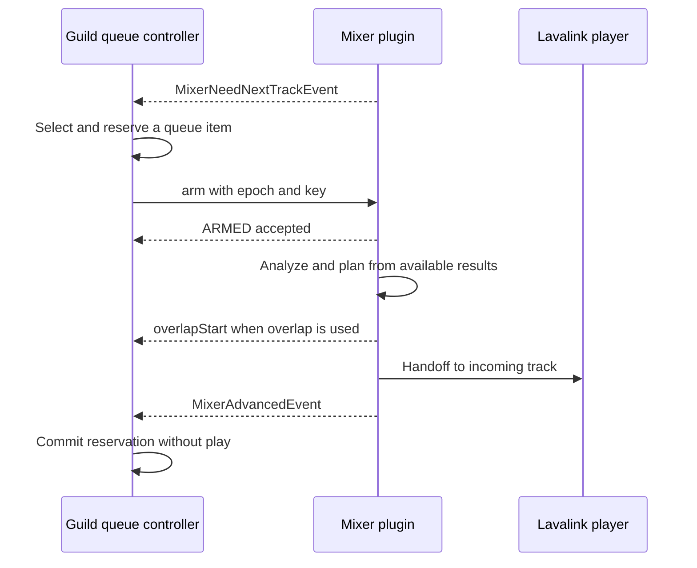

# Bot integration: Mixer protocol v2

[English](README.md) | [한국어 상세 가이드](README.ko.md)

This guide describes the only supported queue-control protocol. The plugin owns
track transitions after the first track starts. The bot must process mixer
WebSocket events, arm the next track just in time, and synchronize its local
queue from server events.

## 1. Install the plugin

Copy `lavalink_mixer-<version>.jar` into Lavalink's `plugins/` directory and restart
the server. Verify the plugin responds to `GET /mixer/info` with Lavalink's
`Authorization` header.

Optional server defaults in `application.yml`:

```yaml
mixer:
  crossfadeEnabled: true
  crossfadeMs: 5000
  fadeInMs: 300
  duckLevel: 0.2
  duckFadeMs: 300
  silenceSkipEnabled: false
  silenceThresholdDb: -60
  silenceMinSoundMs: 120
  silenceHeadScanMs: 15000
  silenceTailScanMs: 15000
  tailConfirmMs: 1000
  normalizationEnabled: false
  targetLufs: -14.0
  bpmDetectionEnabled: false
  bpmScanMs: 30000
  keyDetectionEnabled: false
  keyScanMs: 30000
  beatmatchEnabled: false
  maxTempoChange: 0.08
  beatmatchMinConfidence: 0.30
```

Per-guild settings can also be changed through `/mixer/*` REST endpoints.
Requests use Lavalink's normal `Authorization` header. Use string guild IDs in
JSON; Discord snowflakes are not safe as JavaScript numbers.

## 2. Enable the mixer filter

Before playback, use Lavalink v4's
[Update Player endpoint](https://lavalink.dev/api/rest#update-player):

```http
PATCH /v4/sessions/{sessionId}/players/123456789012345678
Authorization: <Lavalink password>
Content-Type: application/json

{
	"filters": {
		"pluginFilters": {
			"mixer": { "guildId": "123456789012345678" }
		}
	}
}
```

Use the Lavalink session ID from the WebSocket `ready` message. Filter updates
replace the full filter object, so include any other desired filters and preserve
`pluginFilters.mixer`. Reapply it for a replacement player. The filter is required
for crossfade, overlays, fade, and PCM mixing. Confirm it with
`GET /mixer/state?guildId=123456789012345678` and check `mixerFilterActive`.

## 3. Configure optional features

Crossfade is on by default in plugin config, with a 5-second duration. Example
per-guild settings:

```http
POST /mixer/crossfade
{"guildId":"123456789012345678","enabled":true,"durationMs":5000}

POST /mixer/fade-in
{"guildId":"123456789012345678","durationMs":300}

POST /mixer/silence
{"guildId":"123456789012345678","enabled":true,"thresholdDb":-60,"tailConfirmMs":1000}

POST /mixer/normalization
{"guildId":"123456789012345678","enabled":true,"targetLufs":-14}

POST /mixer/key
{"guildId":"123456789012345678","enabled":true,"scanMs":30000}

POST /mixer/bpm
{"guildId":"123456789012345678","enabled":true,"beatmatchEnabled":true,"scanMs":30000,"maxTempoChange":0.08,"minConfidence":0.30}
```

Beat-matched transitions require crossfade, BPM detection, and beat matching all
enabled. Measurements may not be ready for the first transition; the server
uses available trim data and otherwise falls back to ordinary crossfade. Missing
or unknown analysis features keep the configured crossfade duration, bounded by
available outgoing content. The compatibility state label `short_crossfade` does
not imply a 1.5-second fade.

Key estimation is independent of BPM. Check `keyDetectionSupported` on
`/mixer/info`, then read `currentTrackKey` or `nextTrackKey` on `/mixer/state`.
Compare the result's `identifier` with the confirmed track before displaying it.
For `type: "estimated"`, display `key` and `scale`, such as `G minor`.
`type: "unknown"` is a completed inconclusive scan with a `reason`; null means
no completed result is available. Confidence is a heuristic score. The result
covers `windowStartMs` through `windowEndMs`, not necessarily the whole song.
`/mixer/analyze` accepts key-only warmups when key detection is enabled.

## 4. Start the first track normally

Connect the player to voice, enable its mixer filter, then enqueue and play the
first track using your Lavalink client. Do not configure client auto-advance:
set `autoSkip: false`. The bot remains responsible for choosing and starting the
first track only.

## 5. Implement the JIT event flow

Forward raw Lavalink WebSocket messages to the bot's event handler. On
`MixerNeedNextTrackEvent`, choose the current next item and POST
`/mixer/queue/arm` to that node. The request's `encodedTrack` must be the exact
Lavalink-encoded track. If the bot queue is empty, send `isEmpty: true`.
The event fires at `crossfadeMs + 7000ms` remaining, or at
`crossfadeMs + min(2 * bpmScanMs + 7000ms, 120000ms)` when BPM detection and
beat matching are enabled. This gives the server time to scan both tracks.

```http
POST /mixer/queue/arm
Authorization: <Lavalink password>
Content-Type: application/json
Idempotency-Key: <unique key for this operation>

{"guildId":"123456789012345678","epoch":12,"encodedTrack":"<encoded track>","startPositionMs":13520,"outgoingEndPositionMs":190000}
```

Maintain one monotonically increasing epoch per guild. Use a new idempotency
key for each logical operation; reuse it only when retrying that same request.
`startPositionMs` is optional and refers to the incoming track. Check
`/mixer/info` for `incomingStartPositionSupported` before sending a nonzero
position to a node. The server seeks before overlap prefill or gapless playback;
`overlapStart.incomingStartMs` reports the actual overlap start. The position
must leave more than 500ms of a seekable track. Do not send it with `isEmpty`.
`outgoingEndPositionMs` is optional and refers to the current track. Check
`/mixer/info` for `outgoingEndPositionSupported`. It lets a client mark the
start of an outro as the effective end so the fade finishes there. Omit it
when preserving a continuous transition or when the cutoff is already near.
If the queue head changes after arming, call `/mixer/queue/invalidate` with a
higher epoch and a new key. The server can re-emit the JIT request when the
track is still in its transition window, including the earlier BPM window.

When the server sends `MixerAdvancedEvent`, remove/advance the corresponding
local queue item and update now-playing state. **Do not call `play()` for that
track**: it is already playing on the server. Never start a second track from a
client `trackEnd` handler. Keep `autoSkip: false` to prevent a client/server
race.

For an explicit user skip or stop, use `/mixer/queue/override` with a higher
epoch and a unique key. `action: "PLAY_NOW"` also includes the chosen track's
`encodedTrack`; `action: "STOP"` stops playback. Acknowledge completion from
`MixerOverriddenEvent`, not only from the HTTP acceptance response.

On bot startup or session resume, call `/mixer/reset` to synchronize the
server's epoch baseline. Follow `409` conflicts using the server's
`lastKnownEpoch` and, for reset grace conflicts, the returned `windowOpenAt`.

## Features available to the bot

- **Crossfade and gapless handoff**: server-managed overlap when configured;
  otherwise it advances without overlap.
- **Silence skipping**: leading/trailing silence analysis for seekable tracks;
  realtime tail detection is the fallback, including streams.
- **Fade-in and normalization**: per-guild fade duration and EBU R128 target.
- **BPM and beat-matched AutoMix**: opt-in analysis and temporary tempo stretch;
  unsuitable/missing grids fall back to normal crossfade.
- **Announcements**: POST `/mixer/announce`; DELETE
  `/mixer/announce/queue?guildId=...` clears waiting items; POST
  `/mixer/announce/cancel` stops the active sequential overlay. Sequential overlays duck
  music; `mode: "parallel"` uses an isolated overlay player.
- **Diagnostics**: GET `/mixer/state?guildId=...` for queue, transition,
  feature, and analysis state. POST `/mixer/analyze` optionally warms analysis
  caches; it never arms a track or replaces normal queue handling.

For request schemas, bounds, events, and error bodies, see
[`api/openapi.yaml`](../../api/openapi.yaml). The plugin architecture and
verification commands are in [`docs/architecture.md`](../../docs/architecture.md)
and [`docs/development.md`](../../docs/development.md).

## 6. Keep a guild-local queue controller

Keep queue selection separate from queue advancement. Arming reserves the next
item; `MixerAdvancedEvent` commits that reservation. Give every local queue item
its own ID, even when several entries refer to the same encoded track. The
protocol has no field for that local ID, so retain it beside the arm request.

Store the active node/session, current queue item, queue revision, epoch, armed
reservation, and pending command. Retain the exact command path, body, and key
for retries. Process state changes in order within a guild. Before applying an
asynchronous track or segment lookup, recheck the node, current item, and queue
revision captured when that lookup started.



Record a reservation before awaiting the arm response. A delayed response must
not restore a reservation cleared by a newer skip or invalidate. Match an advance
to the reserved queue item rather than unconditionally removing index zero.
Use `handoffId` when available to avoid applying a crossfade twice. Gapless
events may lack that ID, so also compare node/session, epoch, and reservation.
Deduplicating by encoded track alone would suppress legitimate repeated tracks.

`overlapStart` is a display event, not queue confirmation. `overlapEnd` can report
an abort or a native tempo-stretch fallback. Queue advancement follows
`MixerAdvancedEvent`. Override completion follows `MixerOverriddenEvent.requestId`.

## 7. Retry commands without repeating side effects

Use a new key and a higher local epoch for each new logical command. Retries of
the same unresolved command retain its body, epoch, and key. The server accepts
equal epochs with new keys, so an epoch is not a unique server operation ID.

| Result | Client action |
| --- | --- |
| HTTP 200 with `duplicate: true` | Treat as a retained duplicate, not a second action or a replay of the original full response |
| HTTP 400 | Correct invalid input, track data, position conditions, or missing headers |
| HTTP 409 `STALE_EPOCH` | Compare current intent with server state, then create a newer command only if still needed |
| HTTP 409 `PRE_RESET_ARRIVAL` | Wait until `windowOpenAt`, accounting for clock differences, and recheck that the command remains current |
| HTTP 422 | Investigate reuse of a key for a different operation fingerprint |
| Timeout, disconnect, or HTTP 5xx | Reconcile uncertain outcome; retry the same still-current command with the same key using bounded retries |

The server retains 64 operation fingerprints per guild in memory. Reset clears
previous keys, and restart loses them. There is no durable exactly-once guarantee.
Matching keys are checked before epoch/window gating, but track decoding and
input validation can fail before that check. A reset-grace rejection does not
record the key, so the same still-valid command can be retried after the window.

Do not use queue-control retry rules for announcements. `/mixer/announce` has no
idempotency gate; retrying an uncertain enqueue can produce a second announcement.

## 8. Reconcile after reconnect or node migration

Mixer events are sent to the main player's existing socket. Failed deliveries
are not replayed, and the plugin has no event-history endpoint. On reconnect:

1. Query `/mixer/info` on the active node and check protocol/capabilities.
2. Query Lavalink's `GET /v4/sessions/{sessionId}/players/{guildId}` for the actual
   track, position, and filters.
3. Query `/mixer/state?guildId=...` for epoch, armed identity, and transition state.
4. Reconcile the bot queue against actual playback and retained reservations.
5. Reset the protocol baseline and retain the returned `lastKnownEpoch`.
6. Reapply filters and per-guild settings when a replacement player/mixer was
   created, then resume normal JIT handling.

Reset clears the armed transition and defaults to a 1500 ms grace window. It does
not mean stop the current main track. If no main track is playing, start the first
track through the normal Lavalink API; an arm is not an initial-play command.
Node migration does not copy the old node's caches, epoch, keys, or armed slot.
Check delayed responses and events against the currently assigned node/session.

`mixerFilterActive` is a missing-filter diagnostic, not proof of audible output.
Before PCM starts, `true` alone does not establish that the filter ran.

## 9. Preserve one boundary or warm analysis

Use `preserveTransition: true` on an arm to suppress automatic overlap and silence
trimming for that boundary. It is not a persistent album mode. It can be combined
with `startPositionMs`, but not with `outgoingEndPositionMs`. A nonzero incoming
start must leave more than 500 ms; an outgoing cutoff must be more than 500 ms
from both ends of the current seekable track. A cutoff passed or within 500 ms
of current playback when armed is ignored.

The bot obtains SponsorBlock or chapter data and decides which boundaries to
send. The plugin does not query those services. Recheck track identity and queue
revision after a segment lookup before using its result.

`POST /mixer/analyze` warms enabled silence and BPM/feature caches for a seekable,
known-length candidate. Inspect `accepted` in the HTTP 202 response; acceptance
does not mean completion. Normalization still uses the normal arm path. Warmup
does not arm, start playback, or replace the JIT flow. Display `currentTrackBpm`
only when `currentTrackBpmIdentifier` matches the confirmed current track.

## 10. Verify the consuming bot

Exercise ordinary transitions, repeated copies of the same track, an empty queue
followed by an addition, queue reordering, skip/stop during overlap, an identical
key retry, and reconnect recovery. Confirm that the server track, local queue
item, and now-playing display agree after each operation.

The [detailed Korean guide](README.ko.md) includes complete HTTP examples, bot
state fields, error handling, announcements, boundary options, and troubleshooting.
These guides do not ship an executable TypeScript bot or a package manifest.
Validate any client-specific implementation in its consuming bot project. Local
audio tests do not establish live Discord voice playback.
